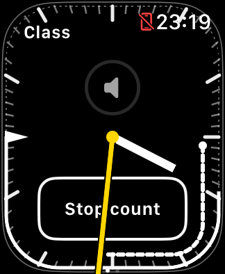
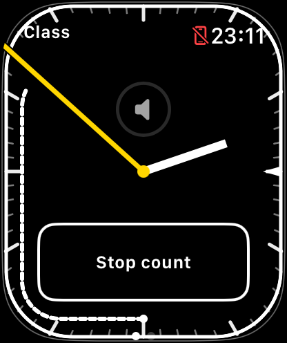
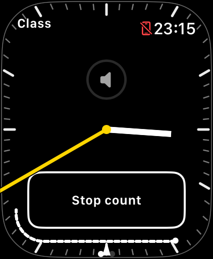

# Teaching Timer

A small, watchOS-only clock for teaching yoga: a prominent ticking second hand,
scheduled class progress, one-minute landmark counts, and native iPhone music
controls. No iPhone companion app, workout tracking, heart-rate collection,
account, advertising, or analytics.

Built around real teaching on Apple Watch SE 3. Still experimental—especially
timed vibrations and automatic runtime renewal. Keep a backup timing method
until you have tested a build in your own teaching conditions.

## Quick start

1. Tap **Start class**. Check the suggested quarter-hour start, adjust with
   **−15 / +15**, choose **60 or 75 minutes**, then confirm **Start class**.
2. Read the long, thin hand for wall-clock seconds and the shorter, thicker hand
   for wall-clock minutes. Both stay in front of the controls. The system clock
   remains at the top right.
3. The inward white wedge marks scheduled class end. For a 60-minute class,
   the heavier outer line shows the time still to come; the light dotted section
   shows the past. The future line ends at scheduled finish, but the wedge stays.
   A 75-minute class has the wedge without a potentially misleading one-hour arc.
4. Turn the **Digital Crown** for the paired iPhone's volume. Swipe left for
   Apple's **Now Playing** controls; swipe right to return.
5. Tap **1-min count** (or **Count** on compact layouts). The inner dashed arc
   traces one minute from the tap. Vibrations mark 10/20/30/40/50/60 seconds with
   1/2/3/4/5/6 pulses. Tap **Stop count** to cancel.

The initial acknowledgement is distinct from the `.directionUp` timing pulses.
Pulses within a group are 0.8 seconds apart. The sixth group begins at 60 seconds,
its last pulse is scheduled at 64 seconds, and the arc's scheduled endpoint is
64.8 seconds. watchOS can deliver completion callbacks later.
If a pulse is at least 0.4 seconds late, further vibrations stop rather than
catch up in a burst. **Vibrations off** appears, but the arc continues on time.

## Class options

Tap **Class**, at the upper left, to:

- **Edit schedule** without resetting the original Start timestamp or services.
- Start a **New class**, including back-to-back classes. Confirmation replaces
  the schedule and stops the old count; an active runtime can continue.
- **Stop session / Resume session** without clearing the class. When the session
  is off, a **Resume** control is also available directly on the face.
- Turn **Count vibrations** off for future visual-only counts, or enable the
  optional **Minutes left** label. Both count modes use the same arc timing.
- **End class** with confirmation, clearing timing and stopping session/count.

The suggested start uses the previous quarter-hour at minutes 0–12 after it and
the next quarter-hour at minutes 13–14. Check it when preparing early: 1:10
suggests 1:00, so choose +15 for a 1:15 class. A class retires automatically
30 minutes after scheduled end. It does not silently start another class.

## Screenshots

Actual watchOS 27 simulator captures, not mockups. Native volume may appear
unavailable without a paired media source. These images do not prove physical
Always-On, Crown responsiveness, or haptic delivery.

| SE 3 · 40 mm | Series 11 · 46 mm | Ultra 3 · 49 mm |
| --- | --- | --- |
|  |  |  |

More checks: [maximum text on SE 3](docs/images/se-40-large-text.png),
[class setup](docs/images/class-setup.png), [locked count](docs/images/se-40-locked.png).
The Ultra example uses a 75-minute class; the other examples use 60 minutes.

## Build and test

Requires Xcode with the watchOS 26 SDK or later; this iteration was checked
locally with Xcode 27.1 / watchOS 27 Simulator and in GitHub Actions. Deployment
target is watchOS 26. Open `TeachingTimer.xcodeproj`, select the TeachingTimer
scheme and a Watch simulator, and Run. For your own physical Watch, select your
Apple development team and a unique bundle identifier under Signing & Capabilities.
No signing keys or provisioning profiles belong in the repository.

```sh
sh scripts/check.sh          # Eight deterministic model/controller/geometry suites
sh scripts/check-archive.sh  # Unsigned archive must actually contain the app
```

These are standalone Swift checks with WatchKit boundary doubles, not an Xcode
unit-test target. GitHub Actions also builds the app for Watch Simulator. Use
normal local/ad-hoc Simulator signing for runtime interaction: an entirely
unsigned build was rejected by WatchKit on the tested simulator.

In Xcode 27 Device Hub, **Controls → Lock (⌘L)** exercises reduced-luminance
Always-On. Simulator haptic requests may sound as Mac speaker chimes. Neither
establishes physical-watch cadence or how the vibrations feel while teaching.

## Runtime, privacy, and limitations

Mindfulness `WKExtendedRuntimeSession` keeps the app useful in the foreground.
It is not a HealthKit workout. Renewal is attempted near expiration when active,
or after eligible interruption on return; **Resume** remains the fallback.
Automatic renewal and one-second Always-On are not guaranteed on every Watch/OS.

Preferences, class context, and bounded runtime/count journals stay in the app's
local container. There is no automatic upload. Journals contain timestamps,
random run IDs, app/build versions, scene transitions, and runtime errors—not
track names or health data. Corrupt journals are preserved separately before
logging resumes. Review/redact logs before publishing them in an issue.

See [current verification and physical checks](DEVELOPMENT_STATUS.md),
[contributor notes](CONTRIBUTING.md), and [historical engineering notes](docs/history/PROTOTYPE_NOTES.md).

## License

The maintainer is choosing a copyleft license. No license has been applied yet;
a public repository alone is not a grant of permission to reuse the code.
