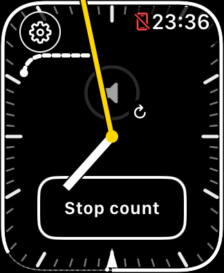

# Teaching Timer

A Watch-first clock for teaching yoga: prominent wall-clock hands, scheduled
class progress, one-minute visual counts with optional vibrations, and native
media controls. An optional iPhone support app helps email diagnostic reports;
teaching works independently on the Watch. No workout tracking, heart-rate
collection, account, advertising, or analytics.

Built around real teaching on Apple Watch SE 3. This is still an experimental
app with known media, volume and Always-On issues. Test it before relying on it
in class and keep another timing method available.



*November 5 interface refinement, SE 3 40 mm Simulator. The gear opens class
controls and Settings. The disconnected-phone symbol is Simulator state.
The installed build and current source candidate are listed in
[current verification](DEVELOPMENT_STATUS.md).*

## Try it

See the [changelog](CHANGELOG.md) for recent beta changes.

New to the dial? The [teaching-face visual key](docs/TEACHING_FACE_GUIDE.md)
explains the hands, perimeter, count arc and controls using a current screenshot.

[**Join the public TestFlight beta**](https://testflight.apple.com/join/YA2WSmae)

The invitation page was checked November 5, 2026 and now offers **View in
TestFlight**. The public group was configured with a 100-tester limit. Public
availability can change; the invitation shows whether places are available.
An installation by a new external tester has not yet been verified.

Open the link on your paired iPhone with Apple's TestFlight app,
then install **Teaching Timer Beta** on your Watch. The app targets watchOS 26
or later; the latest physical pilot used watchOS 27.2. Teaching Timer requires
no app account or iPhone companion interface. Read the
[first-class guide](docs/TESTER_GUIDE.md) and [privacy notes](docs/PRIVACY.md).
Initial feedback can be a description or cropped screenshot; no journal export
is required or promised. To build from source, use the instructions below.

**Owner-pilot validation:** [private diagnostic sharing (#26)](https://github.com/qayshp/TeachingTimer/issues/26)
adds report preparation and native file sharing under Settings → About. The owner
approved an internal TestFlight test after review and CI. Simulator file handoff
is verified; recipient delivery is not. See [current build status](DEVELOPMENT_STATUS.md)
for availability; general testers are not required to send journals.
See the [implementation and validation plan](docs/DIAGNOSTIC_EXPORT_PLAN.md).

1. Tap **Start class**, check **Suggested time**, then confirm the 60-minute class.
   **Custom schedule** changes only this class: adjust its start and choose 60 or
   75 minutes. When starting early, check the suggested quarter-hour carefully.
2. Read the long thin hand for wall-clock seconds and the shorter thick hand for
   minutes. The inward wedge marks scheduled end. A 60-minute class also shows
   the remaining interval around the perimeter; 75 minutes uses the end wedge only.
3. Turn the **Digital Crown** for paired-iPhone volume. Swipe left for Apple's
   **Now Playing** page; swipe right for the clock. Native media can select Watch
   playback, so check the source before class.
4. Tap **1-min count** for an inner arc timed from your tap. Groups of 1–6 pulses
   mark 10–60 seconds. The arc fills at 60 seconds; the count normally ends at
   about 64.8 seconds, allowing time for the final group. Tap again to stop.
   Haptics may be late or skipped by watchOS.
5. Tap the **gear** at the upper left, then **Settings**. Turn **Count vibrations**
   off for the next count or enable **Minutes left**. Both preferences persist.
   **Help**, **Privacy**, and **About** are also in Settings, including the app
   version, recovery guidance, source/license, and private support contact.

**Start class** also requests a mindfulness session to help keep the app available
during class. **Stop session**, **Start session**, and **Resume session** affect
that runtime while retaining class timing. **End class** clears timing and stops session/count. **New class**
creates another schedule with confirmation. An old class retires 30 minutes after
scheduled end; a new class never starts silently.

## When something goes wrong

- Frozen song progress or blank media: swipe to the timer and back to recreate
  the native media view. This may update the displayed position without restoring
  continuously advancing progress; a freeze can also recur after recovery. Eligible
  long-dimmed wakes also refresh automatically; this does not detect a failure.
- Timer Crown volume: tap the native volume display to request refresh; returning
  from media is another recovery path. A visual acknowledgement does not prove
  focus or sound recovered. If playback is silent, the iPhone's volume controls
  have restored it in reported cases.
- **Start session** or **Resume session** appears when the wrist-down session is
  not running. Tap it to request a session without changing class timing.
  Intentional Stop stays stopped across reopening; automatic recovery is bounded
  and watchOS may reject it.

The [known-issue map](docs/ISSUE_TRACKER.md) keeps symptoms and mitigations
separate. [Contact support](SUPPORT.md)
with build/OS, what happened, approximate time and recovery. Do not interrupt a
class to gather evidence or post raw diagnostics publicly.

## Build and contribute

Requires Xcode with watchOS 26 SDK or later. Deployment target is watchOS 26;
the [current verification record](DEVELOPMENT_STATUS.md) lists the tested toolchain
and OS versions. Follow the [Simulator runtime policy](AGENTS.md) when choosing
a runtime. Open `TeachingTimer.xcodeproj`, choose the TeachingTimer scheme and
a Watch simulator, and Run. For your own physical Watch,
select your development team and a unique bundle identifier under Signing &
Capabilities. Credentials, profiles and user-specific Xcode state stay out of Git.

```sh
python3 scripts/check-repository.py
sh scripts/check-tools.sh
sh scripts/check.sh
python3 scripts/verify-build.py work/verification-new
```

The final command repeats the offline checks, builds for Simulator and rehearses
unsigned development/distribution archives. It does not install or upload.
Interactive Simulator checks need Device Hub and are run separately.

Start with [contributor setup](CONTRIBUTING.md), the
[documentation map](docs/README.md), [automation coverage](docs/AUTOMATION.md),
and [publishing readiness](docs/PUBLISHING_READINESS.md).
The [Settings review](docs/SETTINGS_PASS_25.md) and
[form-factor checks](docs/FORM_FACTOR_VALIDATION.md) include labeled Simulator
screenshots. They do not certify physical audio, haptics or Always-On cadence.

In Xcode 27 Device Hub, **Controls → Lock (⌘L)** exercises reduced-luminance
Always-On in Simulator. Haptic requests can sound as Mac speaker chimes.
[Testing boundaries](docs/DEVICE_HUB_TESTING.md) explain the limits.

## Privacy

Preferences, class context and bounded diagnostic journals stay in the app's
container. There is no automatic upload. App journals contain lifecycle/timing
and error information; system diagnostics can contain much more private data.
Review and minimize any diagnostic sharing. See [privacy](docs/PRIVACY.md).

## License

Teaching Timer is licensed under the [Mozilla Public License 2.0](LICENSE)
(`MPL-2.0`). Unless otherwise noted, this covers the project's source, tests,
build configuration, documentation, and original assets.

MPL is file-level copyleft: when distributing modified versions, changes to
covered files must remain available under MPL. See the license for the full
terms and [Mozilla's FAQ](https://www.mozilla.org/en-US/MPL/2.0/FAQ/) for guidance.

## Reliability and distribution tooling

- [Bounded Simulator lifecycle and media-failure captures](tools/simulator-regression/README.md)
- [Isolated native companion-volume probe](tools/native-volume-probe/README.md)
- [Persistence failure diagnostics](docs/PERSISTENCE_DIAGNOSTICS.md)
- [TestFlight identity preparation and diagnostic-access gates](docs/TESTFLIGHT_PREPARATION.md)

Distribution packaging uses `net.qays.TeachingTimer` (qays.net), with Watch payload
`net.qays.TeachingTimer.watchkitapp`. The current
Xcode development installation keeps `com.qayshp.TeachingTimer`; no existing
class or journal is migrated simply by building the distribution identity.

Known bugs and evidence gaps are tracked in [GitHub issues](https://github.com/qayshp/TeachingTimer/issues)
and the [issue/Apple-feedback index](docs/ISSUE_TRACKER.md). Please use the bug
form and keep raw device logs and personal diagnostics out of public reports.

Current remaining work and physical/TestFlight gates: [active roadmap](docs/ROADMAP.md).

### Optional iPhone support companion (development)

Teaching remains independent on the Watch. The optional iPhone app can request a
report while the Watch app is open, or the Watch can send one from
**Settings → Help → Send diagnostics to iPhone**. On iPhone, **Email support** prefills the support address and attaches
the received report. The Watch share sheet is removed in this development change.
One physical Watch-to-phone-to-support-email delivery is verified. Startup,
mail presentation, and upgrade reliability remain under validation.
See [companion validation](docs/OPTIONAL_COMPANION.md).
