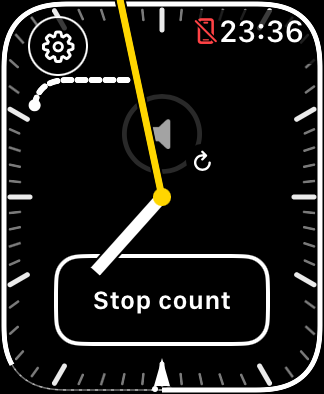

# Teaching Timer

A clock for teaching yoga on Apple Watch. Glance at the wall-clock hands,
track the scheduled class finish, or start a one-minute visual count with
optional vibrations. Use the Digital Crown for paired-iPhone volume and swipe
to Apple's Now Playing controls.

Teaching works on the Watch without an app account. Newer builds include an
optional iPhone app for emailing diagnostic reports. There is no workout
tracking, heart-rate collection, advertising, or analytics.



*November 5 SE 3 40 mm Simulator capture. The public beta uses a **Class**
button in place of the gear shown here. The red icon indicates the simulator's
disconnected phone.*

## Try the public beta

[**Join the public TestFlight beta**](https://testflight.apple.com/join/YA2WSmae)

Open the invitation on your paired iPhone and follow TestFlight's instructions
to install **Teaching Timer Beta** on your Watch. The invitation is titled
**Session Clock**. The public group offered **1.0 (37)** when last checked on
November 26, 2026. Check the installed build in **Class → Settings → About**.
The app targets watchOS 26 or later.

Start with the [first-class guide for build 37](docs/TESTER_GUIDE.md). It covers
class setup, the one-minute count, volume, and recovery steps. Use the
[visual guide](docs/TEACHING_FACE_GUIDE.md) to read the dial. Try the beta
outside class first. Song progress can stall, volume can drop or stop
responding, and wrist-down updates depend on watchOS. Keep another timing
method available while getting to know the app.

## Current source and newer builds

- **Gear → Settings** opens **Count vibrations**, **Minutes left**, and offline
  **Help**, **Privacy**, and **About**. **Start session** and **Resume session**
  name the action that requests wrist-down updates. **Stop session** keeps
  class timing. **End class** clears it.
- The optional iPhone app can request a diagnostic report from the Watch, or
  receive one from **Settings → Help → Send diagnostics to iPhone**. On the
  phone, **Email support** prepares a message with the report attached.
  [Sharing steps](SUPPORT.md#optional-iphone-diagnostics-companion).
- The **Teaching Timer** complication opens the app from your watch face.
  The [Utility setup](docs/TEACHING_FACE_GUIDE.md#teaching-timer-and-native-now-playing-together)
  pairs it with a second launcher for Apple's standalone Now Playing app.

See [current build and verification status](DEVELOPMENT_STATUS.md) for feature
availability and the [changelog](CHANGELOG.md) for changes by milestone.

## When something goes wrong

- **Frozen song progress or blank media**. Swipe to the timer and back. This can
  update the displayed position. For live progress, try Apple's standalone
  **Now Playing** app on the Watch.
- **Crown volume does not respond**. Tap the timer's volume display once or
  swipe to media and back. If playback continues silently, try the iPhone's
  volume controls.
- **Wrist-down updates slow or stop**. **Resume**, **Start session**, or
  **Resume session** requests a session without changing class timing.

[Email support](SUPPORT.md) with the build, approximate time, symptom, and what
helped. A short description or cropped screenshot is enough. The
[known-issue guide](docs/ISSUE_TRACKER.md) tracks workarounds and open bugs.

## Build and contribute

Use Xcode with the watchOS 26 SDK or newer. Open `TeachingTimer.xcodeproj`,
choose **TeachingTimer** and a Watch simulator, and run. Select the newest
compatible runtime under the [Simulator policy](AGENTS.md). If building for
your own physical Watch, configure your development team and bundle identifier
before signing.

For clean, committed source, run the checks, Simulator builds, and unsigned
archive rehearsals together:

```sh
python3 scripts/verify-build.py work/verification-new
```

The [contributor guide](CONTRIBUTING.md) lists narrower checks and setup. The
[automation map](docs/AUTOMATION.md) distinguishes CI, interactive Simulator,
and physical tests. Browse the [documentation index](docs/README.md),
[roadmap](docs/ROADMAP.md), and [publishing gates](docs/PUBLISHING_READINESS.md)
for ongoing work.

## Privacy and license

Preferences, class timing, and bounded diagnostic journals stay in the app's
container unless you choose to share a report. Review the
[privacy policy](docs/PRIVACY.md) before sharing. Keep raw diagnostics out of
[public GitHub issues](https://github.com/qayshp/TeachingTimer/issues).

Source, tests, build configuration, documentation, and original assets are
licensed under the [Mozilla Public License 2.0](LICENSE) unless otherwise noted.
