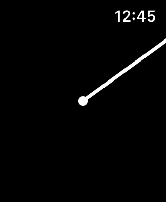
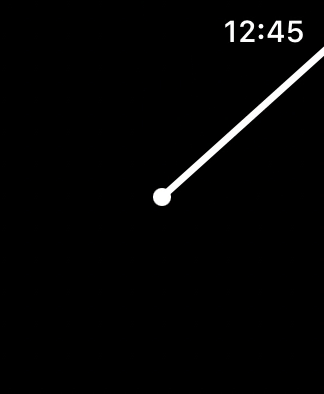
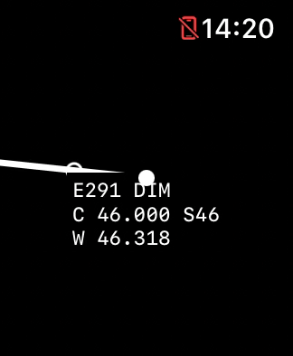
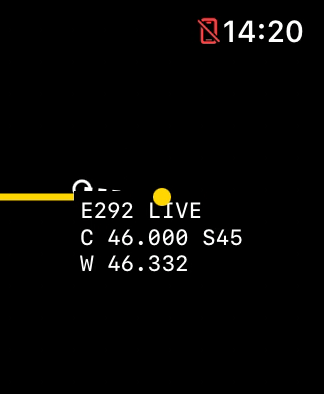

# Seconds-hand transition investigation — October 23, 2026

Filed October 26 as **FB25329087**, with the standalone probe, recordings,
frame analysis, and comparison notes. See [Apple feedback status](APPLE_FEEDBACK.md)
for the remaining capture gaps. No physical-Watch fix is established.

**November 2 update:** an exact-value trace now identifies a numerical boundary
mechanism in the isolated probe. Earlier rounded timestamps could not rule out
input precision and do not establish stale/composited frames. See the
[new diagnosis and candidate](#november-2-exact-date-precision-diagnosis);
the dated investigations below retain their original observations.

## Report and scope

After the 2 p.m. class, the user reported a brief apparent backward step of the
seconds hand when the physical Watch dimmed into Always-On, followed by normal
ticking. No sustained freeze or clock error was reported. This investigation
used the existing SE 3 40 mm watchOS 27.0 Simulator in Xcode 27.1 Device Hub.
No physical device was contacted or installed to.

## Code findings

- `ContentView` supplies one `TimelineView.Context.date` to the timer face.
  Seconds are extracted from that date; the minute hand uses the same date.
- `SquircleClockFace` uses discrete integer-second geometry and Canvas strokes.
  There is no hand rotation animation, accumulated counter, or separate dimmed
  angle calculation. Reduced luminance changes the hand color, not its angle.
- The periodic schedule's `nextWholeSecond` is computed from current time each
  time the parent body evaluates. Luminance, scene, and observed state changes
  can therefore move the schedule anchor forward to the next whole second.
- A temporary opt-in trace confirmed that a dimming update could request a
  future second immediately: at wall time `17:23:54.186`, the context date and
  new schedule anchor were `17:23:55`. About 0.56 seconds later, a context dated
  `17:23:54.722` was requested. Video showed **55 → 54 → 55**.
  Those timestamps are local Simulator log times, not the physical-class event.

The moving anchor is a concrete premature-frame hazard, but it is **not a
complete explanation or proven complete fix**: keeping the anchor constant
still reproduced transition backsteps.

## Bounded experiments

Each video pass covered four Lock/unlock cycles, about 32 seconds. The initial
screenshot pass covered four Lock entries but missed the brief reversal.
Videos were inspected using frame extraction and radial hand-position estimates;
small sub-tick estimate fluctuations from rasterization/color changes were not
counted as full backward ticks. Captures are not a hardware timing benchmark.

| Variant | Observation |
| --- | --- |
| Original scheduling with temporary opt-in context logging; session off | Visible 55 → 54 → 55, plus another backward tick near a later Lock transition |
| Fixed whole-second epoch anchor; session off | Backward ticks still occurred during Lock transitions |
| Fixed anchor plus timeline-content invalidation on luminance changes; session running | Backsteps still appeared, including on unlock; not a reliable remedy |
| Original unchanged build, no per-frame logging; session confirmed running | 1,230 recorded frames; visible backward ticks at approximately 3.82 and 25.87 seconds into the video, both shortly after Lock (22 → 21 and 44 → 43) |

The candidate fixes and per-frame logging were removed. The source and installed
SE Simulator app were restored to the unchanged pre-investigation implementation.
The other Simulator devices and physical Watch were not modified.
All nine deterministic test suites passed. Both temporary instrumented variants
built successfully; neither is retained as a shipped fix.

## Interpretation and next step

The symptom is reproducible; it is not merely a subjective impression of the
yellow-to-white change. The evidence points to the handoff between live rendering
and reduced-luminance timeline frames, with the moving schedule anchor as one
app-level hazard. A stable anchor alone does not eliminate stale-looking frames,
so the remaining cause could involve nested view/Canvas invalidation or watchOS
transition snapshots. This investigation does not establish an Apple framework
bug or prove the physical Watch has exactly the same underlying cause.

The next useful isolation is a tiny standalone timeline clock without session,
media, or nested geometry views, comparing ordinary shape drawing with Canvas
under the same transition sequence. If that also reverses, it provides a small
Apple feedback reproduction. Do not rewrite the working app around a guess.

Do not replace context dates with `Date.now` or clamp every render to the
largest previously requested date. Apple can request future frames in batches;
either workaround can make Always-On content stale or jump ahead. Keep the
landmark arc's monotonic projection intact.

Apple references:

- [Timeline context date](https://developer.apple.com/documentation/swiftui/timelineview/context/date)
- [Updating watchOS apps with timelines](https://developer.apple.com/documentation/watchos-apps/updating-watchos-apps-with-timelines)

Private local evidence is under `work/support/2026-10-23-hand-transition/`:
screen captures, short videos, extracted frames, context logs, and the Simulator
runtime journal. These generated diagnostic artifacts are ignored by Git.

## October 24: clock-only isolation

The investigation continued after the native media recovery was validated.
The same SE 3 40 mm / watchOS 27.0 Simulator was used. Initial isolation builds
replaced the app entry/content with just one TimelineView hand under a separate
bundle identifier; no TeachingTimer state objects or media controls were created.
The small view was then packaged as a standalone app built from a single Swift
file, available in [the clock probe](../tools/timeline-clock-probe/README.md).

Each pass recorded four Lock/unlock cycles, about 32 seconds. The hand was
measured from captured frames; sub-tick rasterization differences were excluded.
The following are observed backward whole ticks, not callback counts:

| Variant | Recorded result |
| --- | --- |
| Clock-only Path drawing, fixed epoch, yellow/white | 47 → 46 at 7.198 s; 6 → 5 at 25.542 s |
| Clock-only Canvas, fixed epoch, yellow/white | 44 → 43 at 21.658 s |
| Clock-only Path, fixed epoch, constant white, first pass | No backward whole tick detected |
| Same constant-white variant, repeat | 49 → 48 at 25.288 s; 53 → 52 at 28.970 s |
| TeachingTimer with temporary fixed epoch and constant-white hand, runtime active | 43 → 42 at 18.015 s; 54 → 53 at 28.995 s |
| Standalone single-file probe, Path, fixed epoch, yellow/white | 24 → 23 at 3.507 s; 35 → 34 at 14.498 s; 42 → 41 at 21.832 s |

The apparent improvement from the first constant-color pass did not survive a
repeat. The full-app temporary changes were removed. The shipped media-recovery
code retains the original hand appearance/schedule; no seconds-hand fix is claimed.

The reduced test demonstrates that session logic, media, landmarks, nested
TeachingTimer geometry, and Canvas are not required to trigger the symptom in
Simulator. It points more strongly toward the SwiftUI/watchOS transition between
live and Always-On frames, without establishing the internal framework cause or
proving identical behavior on hardware. There is now a small reproducible case
for a separate Apple report or a comparison on a newer watchOS Simulator runtime.

Apple's timeline guidance still requires using the supplied context date because
the system may request views up to five minutes ahead. Substituting `Date.now`,
clamping against the last requested future date, or adding a high-frequency timer
would not be a justified remedy. The class/count time models were not changed.

The new private recordings, frame analyses, build logs, and original fixture are
under ignored `work/support/2026-10-24-hand-isolation/`.
The standalone build script, app installation, and launch were verified; its
four-cycle run contained 298 captured video frames. TeachingTimer's separate
journal confirmed a running runtime throughout the full-app candidate's
Lock/unlock pass. The final Simulator app was restored to the committed media
recovery build with its original hand rendering. No physical installation occurred.

## October 28 roadmap follow-through

The selected Xcode 27.1 installation currently supplies the watchOS 27.0 SDK
and only the watchOS 27.0 Simulator runtime (24R362). No useful newer-runtime
comparison is available locally. The independent probe and reproduction method
remain ready for that comparison. No physical Watch was touched, no new hand
workaround was introduced, and no duplicate unchanged observation was sent to
FB25329087. This does not establish that a newer runtime is unavailable from Apple;
it records the installed test environment. The newer-runtime/hardware part of
roadmap item 22 remains deferred.

## November 2: watchOS 27.2 reproduction

The October 28 runtime limitation above is historical. Xcode 27.2 and watchOS
27.2 (24S118) are now available locally; the [newer-runtime app pass](RUNTIME_27_2_VALIDATION.md)
records separate UI/action and paired-media checks. A new SE 3 40 mm recording
of the standalone clock probe reproduced two backward whole-second ticks. The
variant used ordinary `Path` drawing, a fixed epoch schedule and yellow/white
normal/reduced-luminance colors. No TeachingTimer class, runtime, media, volume
or landmark state was present.

The 39.88-second recording contains 174 samples at 324×394 pixels, with strictly
increasing presentation timestamps. Bright-pixel hand-angle measurements flagged
the reversals; the exact decoded before/after and recovery frames were then
visually inspected. Small rasterization differences were not counted as ticks.

| Video time, before → backward frame | Clockwise angle from 12 o'clock | Return to the previous angle |
| --- | --- | --- |
| 12.295 → 12.400 seconds | 54.003° → 47.999°, about −6° | About 0.907 seconds later |
| 31.715 → 31.722 seconds | 167.994° → 161.999°, about −6° | About 0.587 seconds later |

The first event's exact decoded frames are reproduced below. Both hands are
white, so this is a geometric reversal rather than solely a color change.

| Before: 12.295 s, about 54° | After: 12.400 s, about 48° |
| --- | --- |
|  |  |

**Transition direction matters.** Both reversals occurred just before the hand
changed from white to yellow, suggesting the wake-side transition in this run.
The recorded input sequence contains four Lock/tap pairs, but intermediate taps
did not produce a measured return to yellow. Later Lock commands may have toggled
the display back toward normal luminance. Input dispatch is not confirmation of
the resulting screen state: this is not evidence of four completed Lock/wake
cycles or a wrist-down-only reversal. Command elapsed time was not independently
calibrated against video time; the frame/color sequence does not depend on that
alignment.

This newer-runtime result again shows that a moving timeline anchor and
TeachingTimer's other features are not necessary for the recorded symptom. It
does not establish whether the cause is stale/future timeline dates, pre-rendered
frame ordering, snapshots, or another framework behavior. No timeline-date trace
was collected in this pass, no production fix was adopted, and no physical-Watch
comparison was performed.

The evidence is ready to add to existing **FB25329087**; this November 2 update
has **not been sent**. Original video, frame measurements, command records and
analysis remain private under `work/support/2026-11-02-v1-review/clock-probe/`.
The public PNGs above are unchanged copies of decoded frames 46 and 47.

## November 2: exact Date precision diagnosis

A subsequent fixed-epoch, ordinary-Path probe records the context Date's exact
reference-time bit pattern and captures the Calendar second once for both its
hand and diagnostic `S` label. This identifies a numerical mechanism that the
earlier rounded Unix timestamps concealed. Calendar returns the preceding
second correctly when a Date is just below the whole-second boundary.

| Evaluation IDs | Exact reference-date seconds | Captured Calendar seconds | Monotonic separation |
| --- | --- | --- | --- |
| 175 → 176 | `815350835` → `815350834.99999988` | 35 → 34 | 20.752 ms |
| 291 → 292 | `815350846.00000012` → `815350845.99999988` | 46 → 45 | 14.769 ms |

The lower values are one representable Double step, **119.209 ns**, below the
integer. Conversion to the larger Unix-epoch value rounds away this distinction
before printing; more decimal places cannot restore it. All 234 captured IDs
(64–297) are consecutive, with no sampled wall/monotonic reversal. Ten dates
fell one step below a boundary; their Calendar components match the exact values.
The original trace and saved source remain private under
`work/support/2026-11-02-v1-review/clock-render-trace-run3/`.

The video shows 276.013° at 19.656667 s and the immediate backward frame at
19.666667 s, about 270.000°. Labels are still transitioning at that first
backward frame; they must not be assigned a new evaluation ID from angle alone.
The unchanged source frames below compare the clearly readable E291/S46 before
frame with the later E292/S45 frame at 20.185 s, about 270.004°.

| Before: E291, DIM, S46 | After: E292, LIVE, S45 |
| --- | --- |
|  |  |

This explains a backward change in the captured hand input and matches the
reviewed before/after geometry. It does not require a compositor explanation.
Evaluation order still differs from display order: this run also prepared
future views in batches. Neither this result nor those batches establish that
every historical or physical-Watch jump has the same cause.

### Build 33 candidate — bounded Simulator validation

The stateless [`WallClockDisplay`](../TeachingTimer/WallClockDisplay.swift) helper
normalizes only an exact integer reference-time value and its immediate
`nextDown`/`nextUp` neighbors to that integer. Ordinary fractional dates, genuine
clock corrections and future frames remain valid. Wall-clock minute/second
hands and the class-progress display share the normalized sample; the timeline
schedule and raw class/runtime/count state are unchanged. There is no global
last-date clamp, fresh-`Date()` substitution or new timer.

The probe compares the same helper using `--normalize-second-boundary`;
default mode retains the raw baseline. In the normalized comparison, 113 of 234
evaluations again contained a raw Date one representable step below an integer.
All 113 displayed the corrected whole second, including a live-to-dim transition
whose raw input changed 16 → 15 while the displayed input stayed at 16. An
independent replay through the unchanged production helper matched all 234
logged raw/display components and preserved the original Date bits.

Video analysis measured no backward whole tick across 190 frames over 24.283 s.
Future-preparation batches still return to current time in request order; those
are not display regressions and are not clamped. This is a bounded comparison
with the relevant numerical input exercised, not a guarantee against every
transition defect. Private evidence is under
`work/support/2026-11-02-v1-review/clock-render-trace-normalized-run1/`.

Candidate build 33 passes 13 Swift suites, 117 Python tests and all 21 full-app
Simulator UI-action assertions. Clean source `12772ccabb44` passed signed
archive/export, CI, upload and Apple processing; build 33 is Ready to Test /
Internal and assigned to the owner pilot. Physical validation remains pending.
The physical teaching installation remains build 25 and was untouched.
An Apple follow-up draft records this narrower diagnosis, but this evidence has
**not been submitted** to FB25329087.

## Build 34 follow-up: stable schedule anchor

A separate comparison enabled the same boundary normalization in both variants
and changed only the schedule anchor: recompute the next whole second during
parent evaluation, or retain the fixed epoch. Each short pass recorded two
actual dim/wake cycles, confirmed by luminance traces.

| Normalized variant | Captured evaluations | Video samples / duration | Measured backward ticks |
| --- | ---: | --- | ---: |
| Moving anchor | 231 | 192 frames / 23.7617 s | 2 |
| Fixed epoch | 234 | 170 frames / 23.7333 s | 0 |

The moving-anchor trace and reviewed pixels agree on evaluation IDs 6 → 7
(18 → 17; frames 59 → 60) and 120 → 121 (29 → 28; frames 148 → 149).
The context first led wall time by about 0.60 or 0.67 seconds, then returned to
an ordinary fractional date about 43 or 42 ms behind wall time. These near-live
context regressions were about 82 and 165 ms, not one-representable-step errors.
The narrow precision normalization correctly leaves those fractional inputs
alone; it cannot fix the moving schedule's premature next-second input.

The fixed-anchor pass had no near-live input regression. It exercised 112
below-boundary component corrections, so precision normalization still mattered.
Both captures also contained two returns from batches of future requests to
current time. Those request-order changes are legitimate preparation boundaries,
not additional displayed reversals; they were not clamped. Original traces,
videos and `clock-anchor-numeric-analysis.{json,md}` remain private under
`work/support/2026-11-02-v1-review/`.

This is one short pass per variant with instrumentation, not a universal or
physical-Watch result. It separates the moving-anchor mechanism from the
precision mechanism: the earlier raw fixed-anchor failures did not establish
that combining a stable anchor with narrow precision normalization would fail.

Build 34 now combines the fixed epoch schedule with build 33's display helper.
It compiles and passes all 21 full-app Simulator UI-action assertions. A separate
23.815-second runtime-active recording contains 764 analyzed frames, with no
ambiguous hand detections or backward steps. It shows 24 forward 6° ticks,
including 59 → 0; spacing is approximately 0.97–1.03 seconds, median one second.
Reviewed original frames also show white → yellow at the same second 43 and
yellow → white at second 49.

The interface journal confirms two dim entries and two wake returns, starting
already dim. All eight new events retain the same running runtime ID/start,
class identity and running intent, with intentional Stop false and timer page
selected. No invalidation, expiry or replacement is recorded. The landmark
file is byte-identical before/after this video. There is no independent
preference snapshot for this segment, so it does not prove all saved schedule
fields were byte-identical. This was Debug revision `efb06367ef76-dirty`, before
the later clean release artifact; the private audit is under
`work/support/2026-11-02-v1-review/candidate34-clock-analysis/`.

A locked-count run completed all six groups at 64.82272075 monotonic seconds,
with runtime running while the scene was inactive. Its evidence check passed;
33 control captures had no outline warnings. There were 26 OCR warnings, so
text recognition alone was not treated as proof of missing controls. Reviewed
captures show visible controls and advancing monochrome count progress. Logged
group completion is not proof of physical haptic delivery.

These bounded integration results support the combined candidate, not a
guarantee for every transition or physical Watch. Signed release/upload for
build 34 remain pending. Build 33 remains the available owner pilot; physical
build 25 is untouched. No new Apple update or physical fix is claimed.
