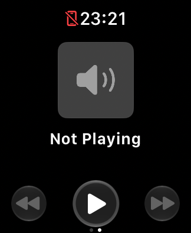

# Historical blank-page reconstruction

Follow-up: the [exact-sequence test](EXACT_LOCK_REENTRY_TEST.md) ran two
Lock/Home/reopen/media/timer passes on October 22 without reproducing a blank
page. Recovery from an already-black page remains untested.

Reviewed October 22, 2026 against the original timestamped tool records and
retained Simulator screenshots. Times below are **October 21, Pacific daylight
time** (the raw records use October 22 UTC). This is a historical reconstruction,
not a fresh reproduction or a claim that every listed action is necessary.

## Important distinction

The clearest original sequence shows **working native Now Playing**, followed
by a **blank timer page on return**. The blank capture has the first page dot
selected and retains the system clock. The later physical report describes
**Now Playing itself** being entirely black, without transport controls.
These are two observations to investigate, not a proven single failure.

## First clearly captured sequence

SE 3 40 mm, watchOS 27 Simulator, Xcode 27.1 Device Hub:

| Time | Recorded action or observation |
| --- | --- |
| 11:18:30 p.m. | Simulated Crown/Home, terminate TeachingTimer, install the current review build, launch normally. |
| 11:18:47 p.m. | Tap Resume; runtime subsequently confirmed active. |
| 11:19:13 p.m. onward | Start a count, wait 17 seconds, capture the face, choose Controls → Lock, wait 20 seconds, capture the dimmed face. |
| 11:20:33 p.m. onward | Inspect journals, press simulated Crown/Home, request app launch **without first terminating it**, swipe toward Now Playing, wait one second, capture. |
| 11:21:01 p.m. onward | Inspect working native Not Playing/speaker/transport UI, swipe back, wait one second, capture the return. |
| 11:21:36 p.m. | Capture again after settling: timer content still black, system time and first page dot remain. |

The latest fresh app launch preceded the failure by roughly 2–3 minutes. This
was not an observed hour-long runtime-expiration failure. An earlier statement
that paging passed was premature and was corrected during that same test run.

## Earlier activity and the baseline comparison

- Before this sequence, the test session included class setup/corrections,
  runtime/count interactions, repeated builds/relaunches, and layout checks on
  Series 11 46 mm and Ultra 3 49 mm as well as SE 3. Device Hub returned to SE 3
  around 11:16 p.m.; the failing round trip itself stayed on that SE simulator.
- At approximately 11:30 p.m., the pre-review `84b10eb` build was installed on
  the **same already-used SE simulator** after terminating the app. Launch and
  swipe attempts produced black captures too. No fresh simulator boot/erase,
  new Lock cycle, class-start sequence, or form-factor switch was recorded in
  that short comparison.
- Both retained baseline captures are identical black images, despite one
  being named `baseline-media` and the other `baseline-return`. File names
  describe intended steps, not proof of the page actually reached. The selected
  first dot is visible. See the [baseline capture](images/simulator-baseline-blank.png).
- Timeline invalidation, moving navigation outside the timeline, recreating the
  view on re-entry, and explicit sizing did not reliably fix the issue. Those
  experimental source edits were removed.

## What this does and does not establish

- **Elapsed time:** no established minimum time or timeout trigger; the clearest
  failure occurred minutes after launch.
- **Repeated classes:** no established number of starts/stops, and no evidence
  that repeatedly ending/creating classes was necessary.
- **Switching simulated watches:** happened earlier, but not between the failing
  swipes. It is a candidate environmental factor, not a demonstrated cause.
- **Lock and foreground re-entry:** present immediately before the clearest
  failure. Earlier commentary called this specifically Lock-related; the
  evidence supports association, not proof of necessity or sufficiency.
- **Older code:** also failed in that same simulator state. This argues against
  attributing the symptom solely to the usability changes, but does not isolate
  app code from persistent native-service/simulator state.

The [October 22 follow-up](SIMULATOR_MEDIA_RECOVERY.md) began with a simulator
boot and did not reproduce a black page through paging, Lock, and an app-only
termination/relaunch. It verified class persistence, **not recovery from an
already-black page**. It did not record the same combined Lock → Crown/Home →
reopen-without-termination → media → timer sequence as the original failure.

If further reproduction is requested, that combined sequence is the best
first candidate, followed by one-variable comparisons. Record screenshots and
page dots alongside lifecycle/journal events; callbacks alone cannot establish
visible content. A black page must be captured before testing force-close
recovery. Do not infer a fix from a healthy page before and after relaunch.
