# Teaching build 16 versus candidate build 19

Compared October 28, 2026. **Build 16 stays on the physical SE 3.** This work
did not query, install, launch or collect diagnostics from physical devices.

The new candidate preserves the teaching UI. Changes since 16 primarily improve
diagnostic retention, persistence diagnostics, automated checks and maintainability.
It does not establish a new fix for media, Crown volume or the hand backstep.

## Comparison method

- Rebuilt the immutable `teaching-build-16` tag (`be1e37e`) with Xcode 27.1.
  Application/project sources match the installed build's `e5e5ab4` source.
  This is a fresh Simulator binary, not the original physical binary.
- Built candidate 19 from the working source subsequently committed as `cef25ff`,
  followed by file-boundary whitespace cleanup in `391c258`. Its comparison
  binary accurately records the pre-commit source as `b74cf715a002-dirty`.
- Used the same disposable SE 3 40 mm and Ultra 4 49 mm simulators, watchOS 27.0
  (24R362). Each comparison begins with a fresh Simulator app container, a
  default class and a count. Physical data and the preserved build-16 checkpoint
  were not changed. The new capture sequences check runtime/count journal starts.
- Captures use real wall time and monotonic counts. Hands, arc starting position,
  scheduled start/end and elapsed progress naturally differ. They are not frozen
  pixel-diff fixtures or edited mockups. The red disconnected-phone icon and
  disabled volume appearance are Simulator conditions.
- These screenshots cover two size extremes at normal text size. Earlier
  eight-geometry/maximum-text checks remain historical evidence; they were not
  all repeated here. Lock captures demonstrate simulated reduced luminance,
  not physical display brightness or pulse delivery.

## SE 3 40 mm

| State | Build 16 | Build 19 |
| --- | --- | --- |
| Start menu | 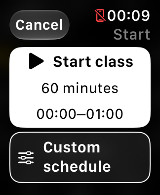 | 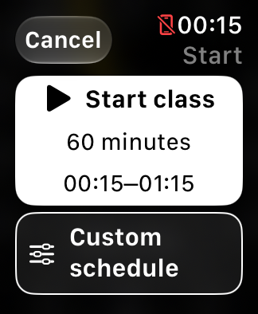 |
| Count, awake | 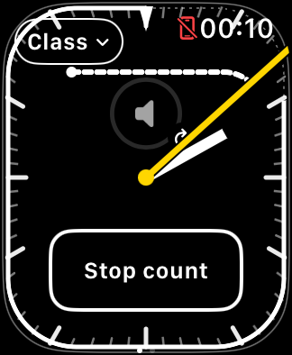 | 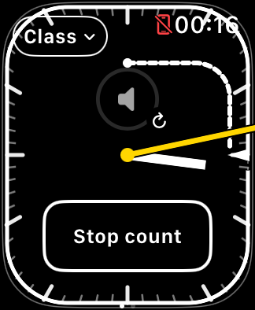 |
| Count, Lock / reduced luminance | 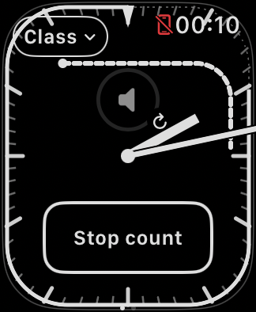 | 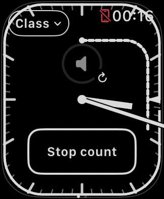 |
| Native media | 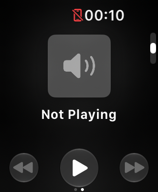 | 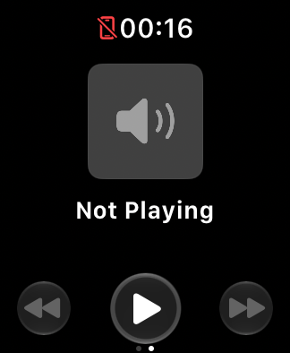 |

The start menu keeps its large primary action and outlined custom action.
The dim face preserves the two hand weights, scheduled-end wedge, inner arc
and large Stop count target. **Build 16's awake count frame lacks the Class
control, which reappears in the subsequent dim frame.** This is a real captured
rendering defect, not an intentional difference in design.

## Ultra 4 49 mm

| State | Build 16 | Build 19 |
| --- | --- | --- |
| Start menu | 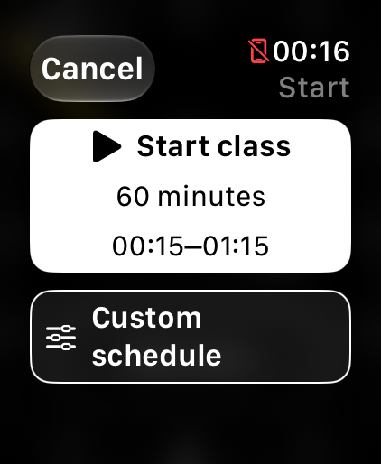 | 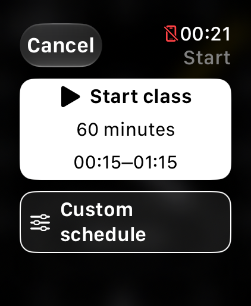 |
| Active class | 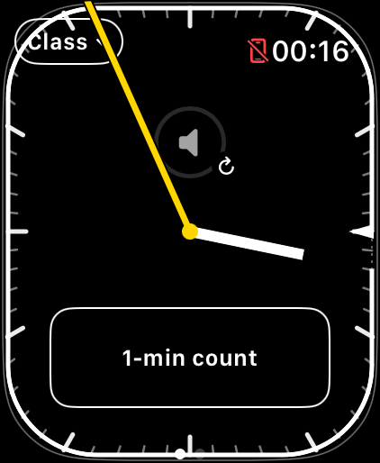 | 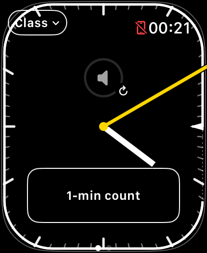 |
| Count, awake | 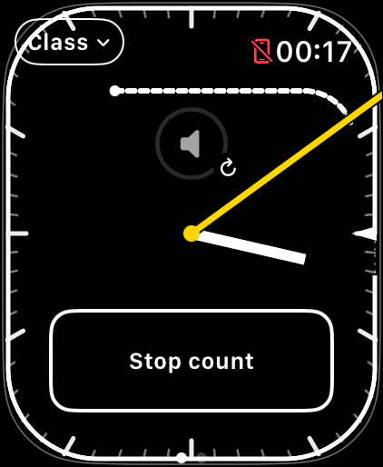 | 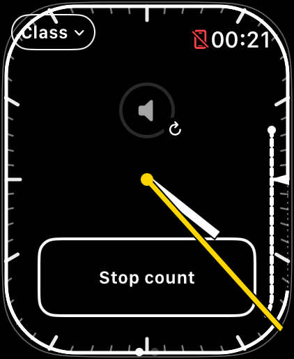 |
| Count, Lock / reduced luminance | 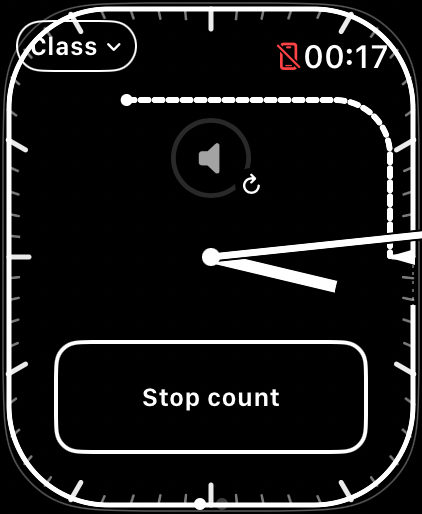 | 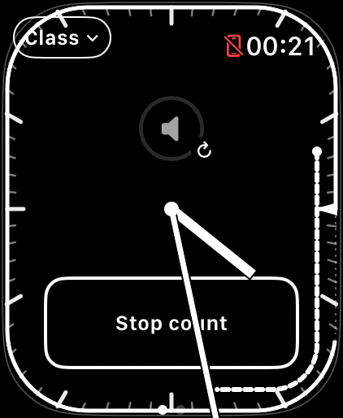 |

**Build 19's awake count capture is missing the Stop count control while the
inner arc is visible.** The preceding active-class frame has its count button;
the subsequent Lock frame restores Stop count. The screenshot records a failure,
not a successful rendering check. Similar missing timer controls were observed
before this split, including build 16 in the SE 3 comparison above; a shared
cause with black native media remains unproven. This warrants focused rendering
isolation, not a claim that the refactor introduced or fixed it.
These individual frames do not establish the duration of the disappearance or
whether the invisible controls still respond to touches.

The new Ultra dim capture also shows the deliberate tradeoff of foreground
hands: a hand can cross the button label. The hands must remain foremost; moving
them behind controls would undo a specific teaching requirement.

## Features and workarounds

| Area | Build 16 on Watch / rebuilt baseline | Candidate 19 |
| --- | --- | --- |
| Teaching face | Squircle, wall-clock minute/seconds hands above controls, end wedge | Same layout, hand meaning and drawing code |
| Class progress | Remaining perimeter for 60 minutes; wedge-only for 75 | Unchanged |
| Start and schedule | Suggested quarter-hour, fixed 60-minute default; separate custom schedule | Unchanged; time-edge regression coverage added |
| Saved class and session | Persisted schedule; intended-running recovery; explicit Stop stays stopped; retirement after scheduled end +30 minutes | Same behavior, with absent/unreadable/write-failure diagnostics and local unreadable-value backup |
| Count | Monotonic arc; optional 1–6 haptic groups; late groups handled without disabling the entire run | Same scheduling; removed unreachable live timeout-warning state while retaining legacy decoding |
| Timer volume | Native companion widget retained; staged startup/background setup, tap refresh and bounded refocus; immediate media-return request | Same widget lifecycle, focus mechanism and recovery policy |
| Native media | Refresh on entry and eligible background return; no redundant Reload media menu item | Same; four additional recovery approaches failed to establish reliability and were removed |
| Operational journal | Seven days / 10,000 events | Unchanged |
| Interface journal | One day / 4,000 events | Seven days / 10,000 events |
| Landmark journal | 2,000-event bound | Seven days / 20,000 events |
| Testing/tooling | Existing deterministic models and manual review | Twelve Swift suites, 40 Python checks, bounded UI/regression runners, build/archive evidence, public issue tracking |
| Source structure | Shared teaching view and embedded helpers | Separate class UI, style, refresh presentation and WatchKit adapter; stable tree and state ownership |
| Distribution | Existing development identity | Development identity retained; separate future `net.qays.TeachingTimer` configuration and draft tester/privacy metadata |

Journal age pruning happens on writes; event caps may truncate a busy period
sooner. Longer retention does not guarantee every event survives. The old
run-wide late-haptic shutdown was already removed before build 16; it is not
a new build-19 fix.

The current workarounds remain limited: tap volume to request refocus; use phone
volume if playback continues silently; re-enter media for a native refresh;
force-close/reopen only when practical, knowing that the count is interrupted.
None is guaranteed. A returned focus call does not prove audio recovery. No
physical audio route, actual volume value or tactile pulse was verified here.

## Verification and decision

- All twelve Swift suites and 40 Python checks pass.
- Simulator build, unsigned development archive and unsigned future-distribution
  archive pass. This does not mean signed distribution or TestFlight approval.
- All 14 essential-action assertions pass on SE 3 and Ultra. The Ultra disk
  persistence assertion needed a bounded 30-second allowance for preference
  flushing; its UI/journal removal was already visible. See [view split](VIEW_SPLIT.md).
- Six focus/lifecycle assertions pass on SE 3, including retained class, host
  and native volume instance. These are state checks, not pixel/audio checks.
- Native media rendered Not Playing in these four comparison captures. This
  does not reverse the known intermittent black-media reproduction.
- Visual review found the missing timer controls described above. Automated
  state passes cannot certify the whole interface as reliable.

Keep build 16 for the planned class as requested. Candidate 19 is a tested
maintenance candidate, not a demonstrated cure for the known teaching bugs.
The [usability review](USABILITY_REVIEW_BUILD_19.md) uses these captures and the
source behavior to prioritize the next changes without implementing them yet.

Private build logs, original journals and test results remain under the ignored
local `work/support/2026-10-28-roadmap-22-25/` directory. Only selected Simulator
screenshots and sanitized findings are published.
