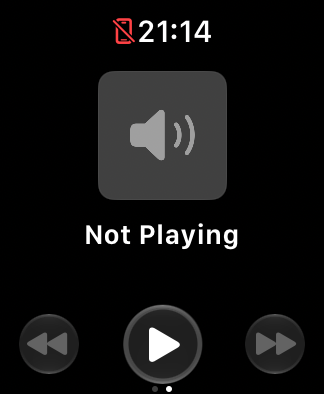
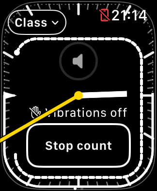

# Lock → Home → reopen → media → timer test

October 22, 2026, approximately 9:11–9:15 p.m. PDT. Application source
`6d2e444`, version 1.0 (5); repository at `ca9b380` before recording this test.
Xcode 27.1 (27A9275), watchOS 27.0, existing SE 3 40 mm Simulator.

## Setup and method

- Kept the already-booted Simulator and its existing class. No erase, reboot,
  simulator pairing change, or native media-service restart.
- Saved the ClassContext; its schedule was 20:45–21:45, 60 minutes.
- Terminated and relaunched TeachingTimer once to match the initial fresh-app
  step of the [historical sequence](BLANK_PAGE_RECONSTRUCTION.md). Tapped Resume
  and verified the runtime-start callback.
- For each pass, started a count, waited 17 seconds, selected Device Hub
  Controls → Lock, then pressed the simulated Crown/Home and reopened using
  `simctl launch` **without terminating the process**.
- Swiped to media, captured after one second, swiped back, and captured both
  immediately after settling and five seconds later. These were actual UI
  drags, not selection-state injection or debug launch flags.
- The first pass stayed reduced-luminance for approximately 27 seconds because
  capture/inspection added time. The second used one scripted sequence with a
  20-second Lock wait, matching the historical timing more closely.

## Results

| Check | Pass 1 | Pass 2 |
| --- | --- | --- |
| Reduced-luminance callback | 21:12:34 | 21:14:11 |
| Home / runtime invalidation | 21:13:01 | 21:14:31 |
| Replacement runtime started | 21:13:02 | 21:14:31 |
| Native media captured | Rendered Not Playing, speaker artwork, transport buttons | Same |
| Return to timer | Rendered immediately and after five seconds | Same |
| Blank media or blank timer | Not observed | Not observed |

The TeachingTimer PID remained 30151 through both Home/reopen sequences, and
the native NanoNowPlayingViewService PID remained 24415. Runtime invalidation
was explicitly `resigned_frontmost`; automatic foreground recovery started a
new runtime. The saved ClassContext before and after both passes was identical,
including original Start timestamp, scheduled start, and duration.

Both counts stopped haptic delivery at the existing 0.4-second lateness limit
(approximately 0.613 seconds late in pass 1, 0.481 in pass 2). The arc and warning
continued to render. No haptic or runtime behavior was changed for this test.

## Limits and next comparison

- This sequence did **not** reproduce either blank-page symptom. No black-page
  recovery test was possible, so force-close/reopen is still not a verified fix.
- Native media had no playback source. Rendering its empty state does not prove
  audio control, audible volume, paired-phone delivery, or AirPlay routing.
- Core Animation/native-service errors also occurred with visibly healthy
  pages. Those messages alone do not identify the historical black-page cause.
- The existing SE Simulator has no paired phone. A subsequently authorized
  [isolated paired test](PAIRED_SIMULATOR_MEDIA_TEST.md) found that the Music and
  Podcasts runtime folders are resources, not runnable installed apps. A Safari
  media session registered on the phone, but neither embedded nor standalone
  Watch Now Playing picked it up. The physical Apple Music → AirPlay → WiiM
  route remains untested in Simulator.
- No application source was changed and no physical device was touched. Private
  screenshots, journals, saved class data, and filtered native errors are in
  `work/support/2026-10-22-exact-sequence/` (not committed).

Apple's [device-testing guidance](https://developer.apple.com/documentation/xcode/running-your-app-on-simulated-or-physical-devices)
distinguishes Simulator coverage from hardware-specific behavior. The reported
physical volume problem still needs physical validation even if a synthetic
Simulator media source becomes available.
