# Simulator form-factor review — October 23, 2026

Reviewed application revision `24705cb` (application source unchanged since
`6d2e444`, version 1.0/build 5). Xcode 27.1 (27A9275), macOS 27.0.1 (26A434),
watchOS 27.0 (24R362). This is a bounded Simulator usability review, not a new
application build feature or a physical-device certification.

## Coverage

The installed watchOS runtime supports 13 Watch profiles with eight distinct
display geometries. One representative of each geometry was created/used,
installed, launched, visually inspected, and exercised in Device Hub. Profiles
listed as equivalent were compared through installed display dimensions and
masks, not individually booted. This does not claim identical hardware behavior.

| Representative tested | Display pixels | Logical points | Same display geometry in installed catalog |
| --- | --- | --- | --- |
| SE 3 40 mm | 324 × 394 | 162 × 197 | — |
| SE 3 44 mm | 368 × 448 | 184 × 224 | — |
| Series 9 41 mm | 352 × 430 | 176 × 215 | — |
| Series 9 45 mm | 396 × 484 | 198 × 242 | — |
| Series 12 42 mm | 374 × 446 | 187 × 223 | Series 10/11 42 mm |
| Series 12 46 mm | 416 × 496 | 208 × 248 | Series 10/11 46 mm |
| Ultra 2 49 mm | 410 × 502 | 205 × 251 | — |
| Ultra 4 49 mm | 422 × 514 | 211 × 257 | Ultra 3 49 mm |

Older profiles visible in the global device-type catalog but unsupported by the
installed watchOS runtime were not counted as available test destinations.

## Results

- Clean signed Simulator build succeeded; all nine deterministic suites passed.
  Layout checks cover 44-point targets and 5,760 count-track points; geometry
  checks cover 17,280 ray intersections.
- All eight representatives rendered the idle face, default Start sheet, custom
  schedule at maximum app Dynamic Type, and native Now Playing empty-source UI.
- Actual taps opened Start, confirmed a default class, and started a count on
  every size. Seven were explicitly cancelled; the SE 3 40 mm count completed
  naturally at approximately 64.86 seconds. Journals corroborated these outcomes.
- Lock produced monochrome/reduced-luminance rendering on every size. Two locked
  captures per size showed changed hand and count-arc positions. This establishes
  progression between captures, **not guaranteed 1 Hz cadence**.
- Horizontal swipes reached Now Playing and returned to a nonblank timer on all
  eight. Journals recorded both page selections with runtime phase `running`.
  The intermittent blank-page problem was not reproduced in this pass; this is
  not evidence that it is fixed.
- Both hands remained above the controls; dial ticks and the scheduled-end wedge
  remained visible. The inner dashed count track stayed clear of control bounds.
- Maximum-text class-present/session-off captures retained readable Count/Resume
  controls and status. Class timing survived these app-only relaunches. The
  runtime itself was not assumed to survive termination.
- On the smallest display, the maximum-text custom form scrolled to Start custom
  class and Back to default; Back to default returned to the default Start sheet.
  This pass did not exhaustively exercise the duration picker, every settings
  toggle, VoiceOver, every locale, or all class lifecycle combinations.

Several count runs stopped vibrations after late submissions while continuing
the visual arc. The warning was visible and readable; seven of eight runs logged
this condition. Multiple simulators were booted concurrently, so these runs are
not a physical haptic reliability or performance benchmark. No scheduling or
vibration behavior was changed.

## Remaining polish findings

1. At maximum app Dynamic Type, the native **Custom class** navigation title is
   truncated/faded on the smallest SE/Series displays. Form actions remain
   readable and reachable; shortening the title is a possible later polish.
2. The maximum-text split **1-min count / Resume** layout is visually tight on
   some intermediate sizes, especially Series 12 42 mm. Targets remain separate
   and labels fit, but an earlier fallback to **Count** could improve breathing
   room. No text/layout behavior was changed during this verification.

The user's deliberate foreground-hand priority remains: hands can briefly cross
control labels. This is not treated as a new regression or silently reversed.

## Pairing and media limits

All eight Watch simulators have retained pair records with the existing
TeachingTimer Clean iPhone (iPhone 17, iOS 27.0). Only one pair is active at a time;
the original TeachingTimer Clean SE 3 40mm pair remains active. Other Watches may
show the disconnected-phone indicator while inactive. Creating pair records does
not establish healthy companion media discovery.

The iPhone and Watches were left booted for manual testing. Added devices are
named **TeachingTimer Size ...**. They contain test class state; use Class to
manage it or Resume if the session is off. The separate Audio Probe fixture on
the iPhone was preserved. No physical Watch or iPhone was changed.

Native Now Playing rendered **Not Playing**, not a completely black media page.
Actual iPhone playback control, route-specific volume, Crown responsiveness, and
physical vibration perception remain unverified by this pass. Focus lifecycle
calls are diagnostic evidence, not proof of effective volume control.

Apple feedback **FB25294079** asks whether paired Simulator media discovery is
supported. See [paired media testing](PAIRED_SIMULATOR_MEDIA_TEST.md) and
[blank-page reconstruction](BLANK_PAGE_RECONSTRUCTION.md) for separate evidence.

## Representative captures

These are unmodified Simulator screenshots from the tested application, captured
at different times/count positions. They are not physical-Watch photographs.

| SE 3 40 mm | SE 3 44 mm |
| --- | --- |
| 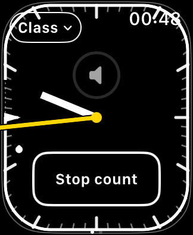 | 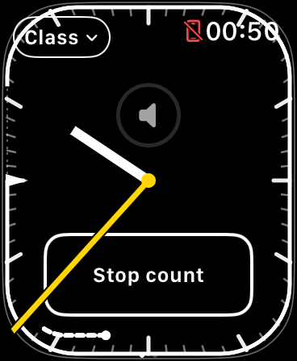 |

| Series 9 41 mm | Series 9 45 mm |
| --- | --- |
| 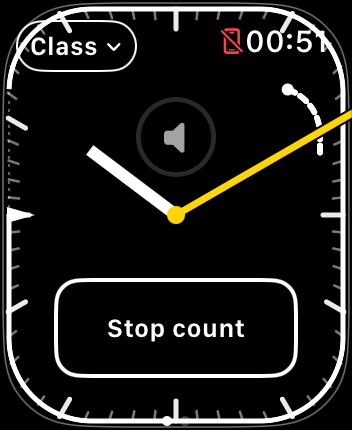 | 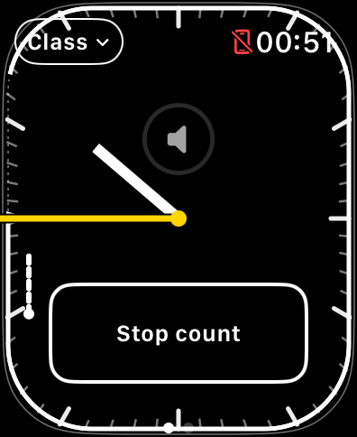 |

| Series 12 42 mm | Series 12 46 mm |
| --- | --- |
| 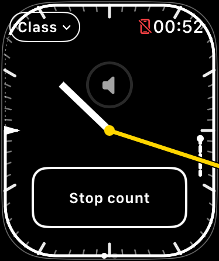 | 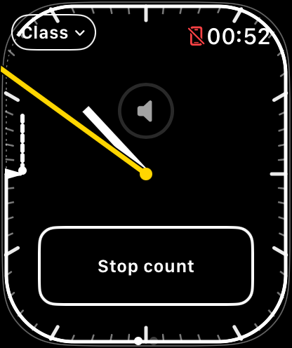 |

| Ultra 2 49 mm | Ultra 4 49 mm |
| --- | --- |
| 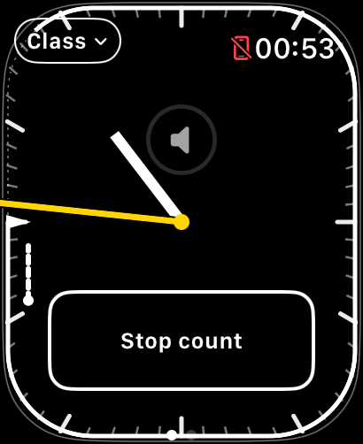 | 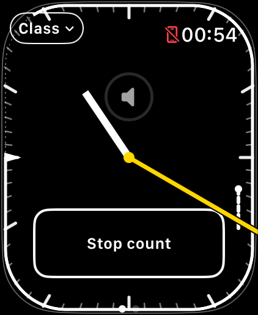 |

| Locked SE 3 40 mm | Maximum-text custom title |
| --- | --- |
| 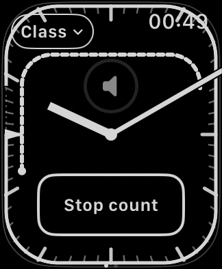 | 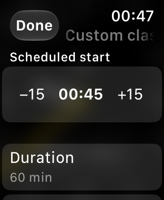 |

| Small-screen custom actions after scrolling | Tight maximum-text split controls |
| --- | --- |
| 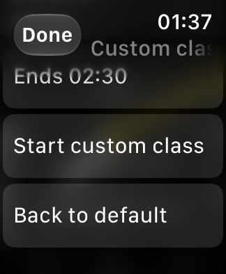 | 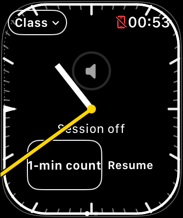 |
