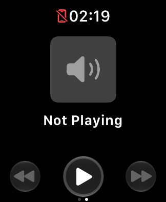

# Issue review — November 6, 2026

This review fetched all 14 open GitHub issues after #4's closure, compared them
with source and retained evidence, and ran focused local and hosted checks.
No physical device, production app behavior, Apple report or distribution group
was changed. Tests and diagnostic tooling changed; journal export remains a
proposal. Apple's last inspected status is still November 5.

## Resolutions

- **#1, blank native media:** resolved by preventive native-view recreation.
  The owner reports no recent recurrence, and the fresh service-loss sequence
  renders Not Playing after recovery with class/host/native-volume identity
  preserved. This resolves the app issue, not Apple's underlying framework
  cause. Reopen on recurrence; frozen progress remains #8.
- **#2, Crown focus after app return:** the retained control and bounded refocus
  address the controlled replacement regression. The supervised Beta 35
  physical test passed all four audible-volume scenarios; the fresh local
  focus run passes all six state assertions. Other routes remain broader #10
  validation, and silencing remains separate #3. Reopen for a new focus failure.
- **#7, premature runtime Start while dimmed:** builds 31–32 address the
  reproduced readiness mistake. The matched Simulator recovery and new
  persisted-intent tests support closure. A different awake-start rejection
  discovered during this review is tracked as #27 below.

Resolution uses a credible correction, relevant tests and subsequent use; it
does not require a guarantee against every future occurrence. Each issue
retains its evidence limits and reopen condition. #4 was closed earlier on the
same principle.

## What the tests establish

The local artifact is the November 6 Debug verification build
`f78d29ec3e62-dirty`, development build string 41. Subsequent commits through
this review do not change app source/project files. It is not an installed
TestFlight build. Tests used Xcode 27.2 (27B52), watchOS 27.2 (24S118), SE 3 40 mm.

- All **13 Swift suites** pass. Commit `73d3cbd` adds eight persisted dimmed-
  relaunch cases: running/Stop/manual-recovery intent, both readiness orders,
  exactly one recovery, preserved class bytes and bounded code-3 failure.
  WatchKit boundary doubles do not prove native callback delivery.
- All **266 Python tests** pass after the media evidence addition. The 41
  targeted media/runner/suite tests include malformed/missing/changed evidence,
  thresholds, helper failures and independent suite rejection.
- **21 action checks**, **five media lifecycle checks**, and a separate **six
  focus lifecycle checks** pass locally. No real phone-volume claim follows.
- The count/Lock sequence captured **33 frames**, all reviewed, plus two
  completion images. No timer control is absent. Fifteen OCR warnings and one
  outline warning are hand occlusion or recognition failures; four unobscured
  dim labels were missed by OCR. The locked count completed at **64.8067 s**
  while the runtime was running. This does not prove physical haptic delivery.

### Media evidence correction and regression guard

The media sequence goes Home, kills exactly the selected disposable Simulator's
native media view service, reopens the same app process, then visits timer/media.
The before-fault and after-return PNGs are byte-identical; all three delayed
captures have visible content in **28.628%** of the measured region. They contain
Not Playing controls. An initial visual reading of the previews as blank was
wrong and was corrected in the user update and issue #1. No new blank-page
reproduction is established.

| Before fault | After return, delayed | After page reentry, delayed |
| --- | --- | --- |
|  |  |  |

Commit `17f7e22` adds a required delayed-content gate: exact capture set,
original-image digests, finite/dimension/region validation and a near-black
review threshold. The actual saved frames pass; a genuine synthetic PNG
sequence with a black delayed frame fails. OCR cannot override the pixel
guard. This prevents lifecycle callbacks alone from certifying visual evidence;
ordinary visible content still does not prove audio or song-progress accuracy.
CI runs its deterministic tests; the full Device Hub scenario remains local.
The tooling commit's [Watch checks](https://github.com/qayshp/TeachingTimer/actions/runs/42203206539)
and [release-tool checks](https://github.com/qayshp/TeachingTimer/actions/runs/42203206494)
pass; this tooling-only change does not rerun the hosted Watch matrix or publish
a TestFlight build.

### New awake-relaunch failure caught by hosted testing

[Watch checks 42201250970](https://github.com/qayshp/TeachingTimer/actions/runs/42201250970)
fails on source `73d3cbd`, Xcode 26.6, Series 6 40 mm / watchOS 26.5 (23T570).
Stopped launches and the first running restoration pass. After a running-process
relaunch, both app and scene report active, with reduced luminance false. Start
is requested at **+0.17594 s** and rejected at **+0.41792 s**, WatchKit error
domain/code 3. System logs independently report insufficient app state; the
capture shows the manual Start session fallback.

This is an actual runtime rejection caught by the smoke test, not a test timeout.
It is distinct from #7's inactive/dimmed submission. An old-session recovery
action appears nearby, but causation is unproven. The failure journal ends at
invalidation and does not prove the final persisted fallback intent. The larger
Watch and later archives were not reached in that run. Keep this evidence under
new [#27](https://github.com/qayshp/TeachingTimer/issues/27); do not relax the
assertion or erase the failure with a retry.

The [separate newer hosted verification](https://github.com/qayshp/TeachingTimer/actions/runs/42201250964)
of the same source passes; publishing is correctly skipped. A passing run does
not negate the failure or establish that the runtime version caused it.

## Remaining work, in recommended order

| Issue | Next useful action and closure criterion |
| --- | --- |
| [#8 Frozen progress](https://github.com/qayshp/TeachingTimer/issues/8) | Still observed on the Watch. Add the existing standalone-versus-embedded comparison to Apple feedback; perform a supervised matched playback/position test. Close after a correction sustains progress through the formerly failing scenario and ordinary use, not merely a refresh. |
| [#9 Runtime intended use](https://github.com/qayshp/TeachingTimer/issues/9) | Send the accurate yoga/renewal inquiry through an agreed Apple support channel. Record guidance or a supported alternative; tests and beta approval cannot answer this policy question. |
| [#27 Awake runtime recovery](https://github.com/qayshp/TeachingTimer/issues/27) | Compare cold launch with immediate relaunch after a running session on both toolchains. Test bounded settling/deferred recovery against the actual rejection, preserve Stop and bounded errors, then rerun the existing failing check. |
| [#26 Private journals](https://github.com/qayshp/TeachingTimer/issues/26) | Validate harmless native attachment delivery; implement the bounded report builder and chosen private transport. [Proposal](DIAGNOSTIC_EXPORT_PLAN.md). |
| [#10 Physical validation](https://github.com/qayshp/TeachingTimer/issues/10) | Use the existing coordinated media rehearsal, teaching-length renewal/battery and accessibility plan. Record actual routes and results; do not substitute Simulator execution. |
| [#11 External beta](https://github.com/qayshp/TeachingTimer/issues/11) | Verify current eligible build and one new external tester's install/update, persistence and support experience. Internal-owner success is separate. |
| [#14 Release safeguards](https://github.com/qayshp/TeachingTimer/issues/14) | Agree required checks and maintainer bypass/recovery, then enforce and verify them. Durable milestone tag/digest work is already complete. |
| [#24 Release ordering](https://github.com/qayshp/TeachingTimer/issues/24) | Model and test serialized allocation/upload, superseded revisions and verification reuse. The DST timestamp reversal remains confirmed; a timezone-only change would not solve source-order races. |
| [#3 Silencing](https://github.com/qayshp/TeachingTimer/issues/3) | No recent recurrence. One bounded initial/Home/refresh/media-return volume exercise on the previously affected available AirPlay/USB routes, with known starting output, can support closure alongside normal use. Capture a recurrence; no universal route guarantee is required. |
| [#17 Startup rendering](https://github.com/qayshp/TeachingTimer/issues/17) | Count/Lock controls are present in the complete new review. Compare repeated early and delayed startup frames on affected sizes; close if this is only initial rendering/capture timing and stable controls remain present. |
| [#5 Developer connections](https://github.com/qayshp/TeachingTimer/issues/5) | At the next relevant failure, collect Apple's requested coordinated CoreDevice evidence. TestFlight bypasses developer installs but does not fix journal/system-log transport. |
| [#6 Simulator media](https://github.com/qayshp/TeachingTimer/issues/6) | Await/check Apple's support answer or try a bounded known sample after a toolchain change. No paired-media baseline exists for meaningful volume/progress assertions. |
| [#15 Performance](https://github.com/qayshp/TeachingTimer/issues/15) | Establish repeatable render/CPU/memory measurements before optimizing. Runtime invariants and seeded event tests are already done; battery belongs in #10. |

Private evidence is retained under the active worktree's ignored
`work/issue-review-2026-11-06/`. Only sanitized Simulator captures are published.
