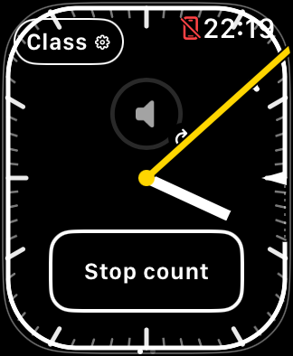
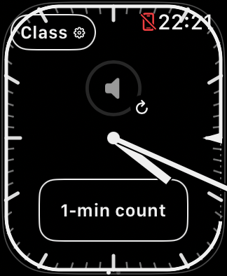
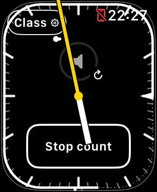

# Bounded media wake refresh

Build 24, October 29, 2026. [Issue #8](https://github.com/qayshp/TeachingTimer/issues/8)
tracks a visible but frozen song-progress indicator, separately from blank media,
timer Crown nonresponse, and volume silencing. The reported class used build 16.
Exact symptom time and the native cause remain unknown.

## Policy

- Record the first reduced-luminance callback using monotonic system uptime.
- On wake, require both active scene and non-reduced luminance, in either callback order.
- Refresh only the selected media page after at least 30 seconds dimmed, and only
  when at least 60 seconds have elapsed since any media refresh.
- Consume the wake even when suppressed. There is no delayed timer or periodic retry.
- Page entry and background-return refreshes clear pending wake recovery and
  update the cooldown timestamp. Existing explicit navigation recovery stays immediate.
- Recreate only the native media host by identity. Do not replace the timer's
  native volume widget, alter its focus sequence, reset class/runtime/count, or
  issue playback commands. A brief native loading/focus interruption remains possible.

The journal records `media_reload_requested` with `source=long_dimmed_wake`,
previous/new generation, scene/luminance and runtime/count context. As with
other preventive reloads, `failureDetected=unobserved`: this is not evidence of
stale pixels or proof that progress recovered. Thresholds are named constants
in `MediaReloadPolicy`; no user setting is added.

## Verification and limits

Deterministic tests cover the exact 30-second threshold, short wakes, callback
ordering, one-shot behavior, 60-second cooldown, timer-page exclusion and
navigation/background deduplication. All 12 Swift suites pass and the Simulator
build succeeds. Existing SE 3 focus/lifecycle checks pass with unchanged class
bytes, host process and native volume identity. Native Not Playing renders.
All 80 Python checks and repository consistency checks also pass.

An actual SE 3 Lock/wake run confirmed reduced luminance, waited 65 seconds,
then toggled Lock off. Exactly one `long_dimmed_wake` refresh occurred. Class
bytes, runtime and native volume identity stayed unchanged; the media screen
rendered Not Playing. Returning to timer requested focus with zero settling
delay and returned in about 12 ms. These are lifecycle/API observations, not
proof of Crown ownership. Initial test-driver attempts checked the wrong journal
and incorrectly assumed a screen tap cleared Lock; corrected verification uses
InterfaceDiagnostics and the explicit Lock toggle. Private evidence is retained
under `work/support/2026-10-29-media-wake/`.

Physical validation remains required: leave real iPhone music playing, remain on
media while wrist-down, wake after a longer interval, observe progress and audio
continuity, try media Crown control, then return to timer and test immediate
Crown volume. Repeat a short wrist wake and several closely spaced wakes. The
Simulator does not establish phone audibility, source selection or Crown ownership.
This build is not installed on the Watch as part of this change.

## November 2 physical Beta 35 follow-up

The [supervised test](MEDIA_PROGRESS_INCIDENT_2026-11-02.md) records both page-entry
refreshes and two eligible `long_dimmed_wake` refreshes on a physical SE 3. Runtime
recovery and class preservation passed when returning from Home and the standalone
Now Playing app; timer Crown checks also passed with iPhone-speaker playback.

The user nevertheless observed embedded progress updating once on entry and then
remaining stale, including during a requested bright-screen comparison. Repeated
page entry produced a newer snapshot rather than reliable ongoing progress.
The standalone Now Playing app appeared to advance normally. These observations
show that native-view recreation does not guarantee live progress. In a follow-up,
the user confirmed that automatic refresh after inactivity does update the
displayed position. This is a useful physical position-catch-up result, separate
from restoring continuous progress. It is not matched to a particular recorded
refresh timestamp and does not establish the underlying cause. The app's timeline
ancestor remains a variable to test.

## November 2 build-38 hosting experiment

[Issue #8](https://github.com/qayshp/TeachingTimer/issues/8) also tracks the
hypothesis that the one-second clock timeline affects the native media host.
Build 38 narrows the rendering boundary without changing the refresh policy:

```text
Before (through 37)                 Candidate (38)
TimelineView                       TabView
  TabView                            TimelineView → teaching face
    teaching face                    NowPlayingView
    NowPlayingView
```

The same parent still owns class, runtime, count, page selection and native-media
generation. The timer's companion volume implementation and focus sequence are
unchanged. Clock/count frames retain their requested timeline Date, stable epoch
and existing invalidation on count/class/clock changes. Class retirement and
runtime synchronization remain outside the timeline so they also run on media.
No periodic reload, playback command or new diagnostic timer is added.

The comparison uses the same booted SE 3 40 mm Simulator, watchOS 27.2 (24S118),
Xcode 27.2 (27B52), and existing action/focus/Lock scripts. Baseline build 37 was
built from clean `2ba6f13`; that revision changes documentation only relative to
the signed source `a36f3be`. Candidate 38 was built from the working source patch;
the private manifest retains its dirty-revision label and executable hash.

Baseline action evidence contains 21 successful checks. The old suite wrapper
expected only 14 and rejected the successful run; its failure is preserved.
[#16](https://github.com/qayshp/TeachingTimer/issues/16) corrects the shared action
contract, and revalidation accepts the original evidence. Baseline focus/class/
native-volume-identity checks pass, as does a complete locked count. Full local
verification passes 13 Swift suites, 131 Python tests, Simulator build, QR checks
and both unsigned archive paths. These checks do not exercise real phone media.

### Fresh missing-label observation

During that baseline's separate 33-frame controls run, original pixels show some
control text absent while outlines and hands remain. Seventeen frames triggered
text-review warnings; the count-0 sequence contains repeated absent labels.
Later frames restore them. This is new evidence in
[#17](https://github.com/qayshp/TeachingTimer/issues/17), not a reinstatement of the
withdrawn historical screenshot interpretations or a physical-Watch reproduction.

| Baseline 37 at 22:19:08 PST | Same run after locked count completion at 22:21 PST |
| --- | --- |
|  |  |

Both images are original Simulator captures from November 2, 2026. The first
capture's display/scene state is not established solely by its stage name;
the full-count finish has separately verified locked-state evidence. A normal
completion callback alone is not proof that every intermediate frame was useful.

Candidate 38 passes all 21 actions, all six focus/lifecycle checks and the full
33-frame/locked-count sequence. Both builds retain the same running runtime ID
across the final media→timer round trip, and report an active count at media entry;
no runtime start/stop/invalidation occurs within that round trip. The native
volume instance and saved class bytes are preserved. Native Not Playing renders.

The candidate's reviewed ready/count/locked/wake/cancelled/finish images contain
labels, sometimes crossed by the hands. Its 22 text-review warnings versus the
baseline's 17 are not a meaningful regression score: inspected candidate warnings
include text that is present but partly crossed by the minute hand. Selected
originals were reviewed, not every pixel of every frame, and one comparison
cannot establish a reliable missing-label fix. Candidate count frame:



The code is an experimental branch/PR, not a distributed fix. The issue stays open: native Not Playing rendering does not establish continuously
accurate song progress. A matched physical A/B comparison must keep the phone
track/output route fixed, compare at least 30 seconds of bright-screen progress
against the phone or synchronized video, then check dim/wake, playback continuity,
Crown response and saved class/count/runtime state. No physical install or
TestFlight upload is part of this Simulator experiment.
