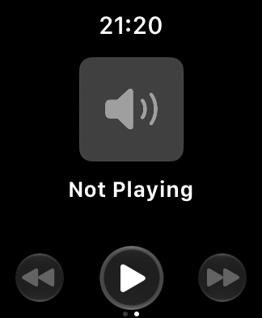
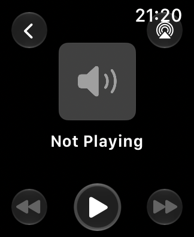

# Isolated paired-Simulator media test

October 22, 2026, approximately 9:17–9:25 p.m. PDT. Xcode 27.1 (27A9275),
iOS 27.0 / watchOS 27.0, unchanged TeachingTimer version 1.0 (5), application
source `6d2e444`.

## Setup

With explicit permission, created **TeachingTimer Media Test iPhone** (iPhone
17e) and **TeachingTimer Media Test SE 3** (40 mm) and paired them. `simctl`
reported the pair active and connected; Device Hub displayed the pairing too.
No existing Simulator was erased or re-paired. No Apple Account sign-in,
subscription, physical-device interaction, or TeachingTimer source edit.

The iOS runtime has a `Music.app` directory, but it contains resources rather
than a runnable Music application. The installed-app listing confirms that
Music and Podcasts are absent; Safari is available. The earlier observation
that the runtime "includes Music" did not establish a playable Music app.

Used an ignored, temporary, loopback-only web server to serve a quiet generated
tone and an HTML audio page in Safari. The page provided Media Session metadata
and play/pause/next/previous handlers. This is a diagnostic fixture, not an
iPhone companion for TeachingTimer.

## Observations

1. Safari's audio time advanced with `paused = false`. The **iPhone's system
   media journal**, independently of the page's own status, selected Safari as
   its active player, recorded `Playing`, and received the title
   **TeachingTimer test tone** and playback rate 1.0. This confirms a phone
   media session, not an audibility measurement.
2. TeachingTimer's embedded Watch Now Playing rendered normally but remained
   **Not Playing**, with speaker artwork and transport controls.
3. Apple's standalone Watch **Now Playing app also remained Not Playing**. The
   missing source is therefore observable outside TeachingTimer, although this
   does not identify whether Safari-source support, Simulator media bridging,
   or another simulator service/configuration condition is responsible.
4. Created a fresh class through the Watch UI (21:15–22:15, 60 minutes), started
   runtime and a count, and attempted the same 17-second lead-in / 20-second
   Lock / Home / reopen / media / timer sequence. Both pages rendered and the
   saved ClassContext before/after was identical.
5. **Important limit:** despite a successful Device Hub Lock action, this fresh
   Watch did not emit `luminance_changed`, and the capture retained the yellow
   seconds hand. This pass is not verified reduced-luminance coverage. The two
   original-Simulator passes did verify that transition separately.
6. The later Watch screenshots showed the red disconnected-phone icon even
   though `simctl` still listed the pair as active/connected. Thus a configured
   Simulator pair must not be equated with working application/media transport.
7. The simulated iPhone's Control Center was also visually empty apart from
   its surrounding controls, even after waiting. This separate system-UI
   observation further limits using this fresh pair as a reliable media test
   environment; it is not a reproduction of TeachingTimer's black page.

## Conclusions

- No blank TeachingTimer page was observed; force-close recovery is still not
  tested against a failing page. No recovery claim or production workaround.
- Pairing alone did not make this simulated phone's active media available to
  the Watch. The test does **not** prove all simulated media is unsupported.
- There was no demonstrated end-to-end media/control path on which to test the
  reported Apple Music → AirPlay → WiiM volume problem. No claim that the volume
  bug was reproduced, fixed, or ruled out. Browser `audio.volume` is a local
  element setting, not the paired phone's system/AirPlay volume.
- A future native iPhone audio fixture could distinguish Safari-specific
  behavior from more general Simulator bridging, but should be a separate,
  bounded investigation. Physical source/route comparison remains necessary
  to investigate the reported classroom incident directly.
- The temporary audio process was stopped and the two new simulators shut
  down, not deleted. Their pair and app data remain available. The original
  unpaired SE and physical devices were not reconfigured.

Private fixture, screenshots, journal excerpts, and class snapshots:
`work/support/2026-10-22-paired-media/` (ignored). Related:
[verified original-Simulator sequence](EXACT_LOCK_REENTRY_TEST.md).
