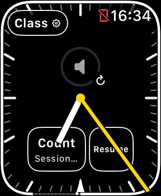
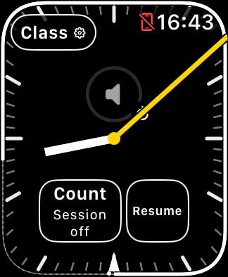
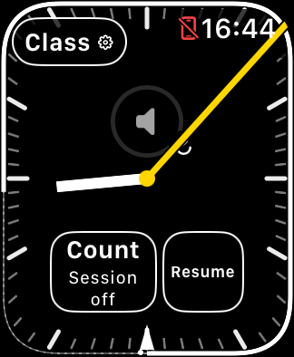

# Repository and Simulator review — November 5, 2026

This review covered the app and state boundaries, release workflows, diagnostic
tools, public documentation, all 18 existing GitHub issues (15 open at the start),
seven Apple reports, five available Watch display sizes, and local artifacts.
No physical Watch or iPhone was used, installed, or queried in this review.
App-affecting commits use the existing automatic internal TestFlight workflow;
publishing is separate from installation or physical validation.

## Changes made

| Commit | Result |
| --- | --- |
| `c74cb3b` | Treat the bundled privacy policy, license and build-metadata script as app inputs. Compile diagnostic fixtures/helpers when Mac tooling changes. Accept the current dotted build numbers in manual release validation. |
| `ed55963` | Add a runtime invariant table and 1,280 reproducible mixed lifecycle events through the actual controller with test doubles at native boundaries. |
| `cab6ded` | Preserve bounded helper stderr/stdout in Simulator-runner failure reports, including timeouts. |
| `bfe9261` | Reconcile public beta status, README/screenshots, icon provenance, Apple status, and a current teaching-face visual key. |
| `dfb7ac4` | Keep the complete **Session off** status readable beside Resume, including SE 3 40 mm and maximum text size. |

The code review did not justify rewriting native media/volume lifecycle or the
separate class, runtime and count models. Instead, the review strengthened
regression coverage around their current behavior. The small layout correction
does not change scheduling, Crown focus, class state or runtime recovery.

## Usability findings and verification

The complete SE 3 40 mm regression suite ran in Xcode 27.2 (27B52), watchOS 27.2:

- **21/21 action assertions** passed: class creation/editing, cancel/new/end,
  information pages, settings, count, Stop/Resume and navigation.
- **6/6 focus/lifecycle assertions** passed: same retained host and class data,
  no new native volume instance, media selection and expected refresh requests.
- The locked count captured **33 frames** and completed normally at **64.807
  seconds**, with runtime running and scene inactive. Reduced luminance was
  confirmed. This does not verify physical haptic delivery.
- Seven text-recognition warnings were inspected against every flagged original
  screenshot. The expected controls were present; foreground hands obscured
  parts of their labels. Those warnings are not missing-control reproductions.
- The inspected media page contained native **Not Playing** controls, not a
  blank page. Paired phone playback remains unvalidated in Simulator.

The first suite attempt failed because Device Hub had no usable window. Opening
its window enabled the successful bounded retry; no platform reset or re-pairing
was performed. The new failure-output handling makes this class of helper error
visible without discarding the original exception.

Idle faces were also captured at normal and maximum app text size on SE 3 44 mm,
Series 12 42/46 mm and Ultra 4 49 mm. Some early captures lacked native/system
elements that appeared in later captures. Keep [#17](https://github.com/qayshp/TeachingTimer/issues/17)
open: these images do not distinguish rendering delay, capture timing or a
persistent failure. This was a layout review, not a full action suite on every size.

One clear layout defect was fixed: the narrow count control beside Resume said
`Session…`, hiding the important word **off**. It now permits two centered lines
in that split layout. The existing running-session layout and touch targets are
preserved. Focused SE 3 checks confirmed count start/cancel while stopped and
successful Resume; the stopped state is also readable on Ultra at maximum text.

| Before — SE 3 40 mm | After — SE 3 40 mm | After — maximum text |
| --- | --- | --- |
|  |  |  |

The baseline was local development build 41 from clean source `5fcef3cc207a`.
The candidate artifact records `cab6ded921bf-dirty`; its app-source difference
is the layout fix subsequently committed as `dfb7ac4`. Dirty documentation was
also present during that build. The screenshots are unaltered Simulator captures,
not physical-device results or a claim about the currently installed beta.

## Automated checks and remaining gaps

All **13 Swift suites** and **180 Python tests** passed locally. The seeded
runtime test uses eight fixed seeds and 160 events per seed; failures print the
seed and recent actions. All four diagnostic fixtures and four inspection/input
helpers compile. Simulator builds of the baseline and layout candidate passed.
See [runtime invariants](RUNTIME_INVARIANTS.md) and [automation](AUTOMATION.md).

Hosted verification of `c74cb3b` passed. Two intermediate commits exposed a
documentation-index omission for the new invariant document; `bfe9261` links it
and the hosted check passed afterward. The failure was the repository checker,
not a failing runtime assertion.

GitHub still builds for Watch Simulator and runs host-side tests; it does not
boot and execute the Watch app. New [#23](https://github.com/qayshp/TeachingTimer/issues/23)
tracks a bounded hosted boot/install/launch/journal smoke check.

Release review also found that local Pacific date/time build numbers can
decrease during the autumn repeated hour. The synthetic sequence is
`261101.0159.50` then `261101.0100.51` as UTC advances across the 2026 fall-back.
No rejected Apple upload is claimed. New
[#24](https://github.com/qayshp/TeachingTimer/issues/24) covers numbering,
publisher ordering and avoiding duplicated verification. Required-check
enforcement on main is still absent and remains part of #14.

## GitHub and Apple follow-up

Closed [#13](https://github.com/qayshp/TeachingTimer/issues/13) (visual onboarding),
[#22](https://github.com/qayshp/TeachingTimer/issues/22) (release-input/tool coverage)
and [#25](https://github.com/qayshp/TeachingTimer/issues/25) (recovery-label layout).
Updated the open bug/release issues with current evidence. #15's lifecycle-test
portion is complete; its performance baseline remains open.

No intermittent physical bug was closed based on Simulator success. Frozen
progress remains confirmed on owner-reported TestFlight `261104.1939.6`;
blank media and volume silencing remain apparently mitigated after the owner's
corrected report of no recurrence. The [ranked roadmap](ROADMAP.md) and
[issue map](ISSUE_TRACKER.md) distinguish these states.

Feedback Assistant was refreshed and the seven submitted reports inspected.
No new technical reply was found. The connection report remains **Investigation
complete — Unable to diagnose with current information**. Apple's existing
request is to reproduce with the CoreDevice logging profile if possible, then
run `xcrun devicectl diagnose`, ensuring host and relevant-device sysdiagnoses
are included. The other six reports remain open. See [Apple feedback](APPLE_FEEDBACK.md).
No new Apple message or device capture was sent during this review.

The public TestFlight invitation now presents joining instructions and **View in
TestFlight**. Its exact eligible build and a new external tester's installation
were not established by that public-page check.

## Local artifact cleanup

An inventory and exact deletion manifest were retained privately. Removed 146
explicit generated compiler-cache/intermediate directories: 32,634 files,
**2,250,096,640 allocated bytes** (about **2.10 GiB**). These are regenerated by
future builds. Each candidate was checked for symlinks and protected paths.

Preserved signed products/archives, rollback checkpoints, raw journals,
sysdiagnoses, Apple attachments, logs needed for existing investigations, source
worktrees and evidence manifests. No irreplaceable class evidence was deleted.
Small old worktrees were retained because their ancestry was not sufficiently
clear to justify removal for negligible savings. The private maintenance
catalog records the exact paths and completed deletion results.

## Next work

Start with frozen-progress evidence for Apple and supported runtime policy;
coordinate physical reliability/accessibility and first-external-beta checks.
Laptop-only work can proceed in parallel on release ordering, durable release
provenance, hosted Simulator execution and a measured performance baseline.
The [roadmap](ROADMAP.md) owns priority and issue acceptance criteria.

## Follow-up — compiler hygiene, recovery wording and real CI launches

The follow-up keeps the native volume/media implementation and separate class,
session and count behavior. It replaces the upper-left Class capsule with an
outlined gear and retains a 44-point touch target and descriptive accessibility
label. The recovery action now spells out **Start session** or **Resume session**;
**Session off** no longer appears inside Count. The class menu explains the
session under **Wrist-down updates**. Updated [guide screenshots](TEACHING_FACE_GUIDE.md)
show the exact local development artifact, not a physical Watch or released beta.

Complete Swift concurrency checking exposed three previously hidden delegate
warnings. A private immutable identity token now retains the originating native
session only while its callback is queued; identity comparison and native API
access remain separated. Stale callbacks cannot alter the replacement session,
and a new test verifies the token releases its retained session after delivery.
The WatchKit class itself is not declared Sendable. Debug, Release and TestFlight
builds, standalone Swift checks and diagnostic helper builds reject compiler
warnings. Xcode still emits its separate no-AppIntents metadata-extraction warning;
no unused framework or blanket warning suppression was added.

A small EditorConfig and source hygiene check enforce existing spacing, line
endings, final newlines and absence of trailing source whitespace. Shell files
are syntax-checked without execution. This avoids a whole-repository reformat
while preventing new basic style/syntax problems.

Local validation passed all 13 Swift suites, 197 Python tests, all eight native
fixture/helper compilations, the Simulator build and both unsigned archive checks.
The new bounded smoke creates its own Watch, runs three real app processes and
checks exact saved-class/intentional-Stop persistence from fresh journals before
deleting only its device. Both hosted verification workflows now invoke it;
hosted results are separately recorded after execution. This is not interactive
UI, paired media, haptic or runtime-acceptance validation.

The SE 3 action suite passed 21/21 assertions. Its first attempt missed a native
Back button; moving the harness tap to the center enabled the complete retry.
Visual inspection caught mid-word wrapping in the initial recovery label, which
was corrected and rechecked at normal/maximum SE 3 text size and maximum Ultra
text size. Count cancellation and session resume were exercised separately.
The focused lifecycle suite passed all six assertions, retaining the app host,
class bytes and native volume instance. Native/audio effects remain unverified.

Main-branch Watch checks now have per-commit concurrency groups, so a later
lightweight documentation push cannot cancel required app verification. PR runs
still replace older runs of the same PR. Release ordering, daylight-saving
build-number reversal and verification reuse remain in #24. Public screenshots
are unaltered Simulator captures; raw journals and failed-test evidence stay local.

### Hosted follow-up — November 6

At source `8ddde8f`, both hosted verification workflows passed all 14 stages,
including actual disposable Watch launches and unsigned archives:

| Workflow | Watch runtime | Runtime setup | Smoke |
| --- | --- | --- | --- |
| [Watch checks](https://github.com/qayshp/TeachingTimer/actions/runs/42184213888), Xcode 26.6 | 26.5 (23T570) | Existing runtime; 4.238 s check | 98.719 s |
| [Release verification](https://github.com/qayshp/TeachingTimer/actions/runs/42184213880), Xcode 27.2 | 27.2 (24S118) | 94.781 s, including 90.661 s download/install | 152.214 s |

The first Xcode 27 release attempt had no installed Watch runtime and failed
before signing/upload. The explicit setup helper resolves that ephemeral-runner
dependency; it refuses local/self-hosted execution and makes one bounded attempt.
The final Python suite contains **204 tests**. Issue #23 is closed with these
actual hosted results. It does not establish paired media or physical behavior.

Idle gear/control layouts were additionally reviewed at normal and maximum text
on SE 3 44 mm and Series 12 42/46 mm. Together with the SE 3 40 mm and Ultra checks,
all five currently installed form factors were inspected; the full action suite
was run on SE 3 40 mm only. No physical Watch was accessed.

Removed six regenerable compiler-cache/intermediate directories from this
follow-up's local builds: 101,097,472 allocated bytes (about 96.4 MiB). The exact
plan/result remains private. Products, archives, screenshots, journals and
successful/failed check logs were preserved.

The same source was then published through the normal manual release path as
**1.0 (261106.0007.20)**. [Release run 42185416986](https://github.com/qayshp/TeachingTimer/actions/runs/42185416986)
passed signed export, upload, Apple processing (`VALID`), test-note readback and
Maintainer pilot assignment (`IN_BETA_TESTING`). Availability was first confirmed
November 6 at **00:22:06 PST**, 112.32 seconds after upload completion. Verification
used Xcode 27.2 (27B52); the separate signing/export runner used 27.2 (27B48).
The immutable source remained `8ddde8f86985485a80fb3ba5cce0d7fdc527b3b5` in both.
CodeQL passed for that source. No physical installation or device query occurred.
