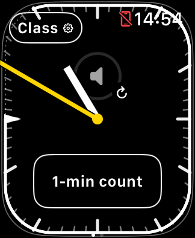
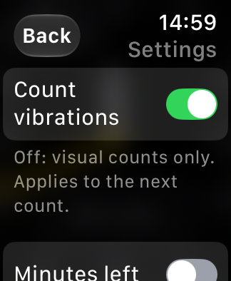
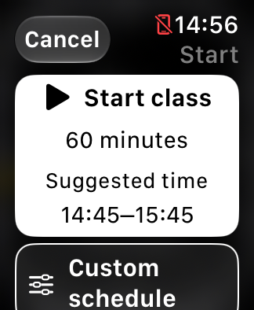
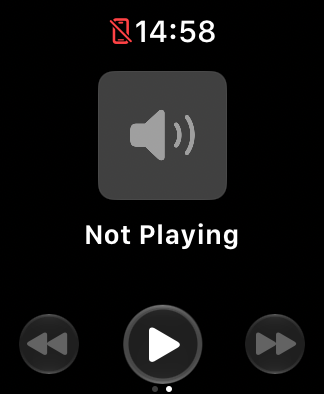

# Build 26 on the newer Simulator runtimes

October 31, 2026. Xcode 27.2 (27B52), iOS 27.2 (24B8117), watchOS 27.2
(24S118). One dedicated iPhone 18 Pro / SE 3 40 mm pair was created for this
work. No physical devices were used. Other default devices were not reset,
re-paired or booted. This is not an all-form-factor validation pass.

## App actions

All 15 essential-action assertions passed, including Settings before class,
Settings → Back in a replacement-class draft, unchanged saved class until
confirmation, count start/cancel, runtime stop/resume, schedule cancel/save,
class replacement, End class and media/timer navigation. Source app behavior is
build 26; no production code changed in this pass. Selected screenshots were
visually reviewed. Settings labels wrap and its second switch requires scrolling
on the SE 3. VoiceOver and physical Crown/audio/haptic effects remain unverified.

The first action run did not open Start class: automation input was ineffective.
A targeted trial with a longer Device Hub selection delay and a pointer move
before the click succeeded. Applying that same input sequence to the runner
allowed its complete action pass. This is an automation-helper adjustment, not
an app touch-target or native-focus change. The failed attempt remains private.

| Active face | Settings on SE 3 | Back returns to the new-class draft |
| --- | --- | --- |
|  |  |  |

## Paired media: baseline still not established

CoreSimulator reported this new pair active/connected. The standalone native
[phone fixture](../tools/phone-audio-probe/README.md) logged actual playback,
with visible advancing position. TeachingTimer's native media view showed
**Not Playing**, including the disconnected-phone system symbol. A pair-state
flag does not establish complete Watch–phone service connectivity.

A standalone Watch Now Playing capture had navigation/source chrome with empty
content. It was a single early frame, so it is inconclusive; it must not be
classified as another proven black-media regression or a completed discovery test.
No companion volume/transport or song-progress baseline was established. The
fixture handles native remote commands, but none was observed; no claim is made
that a failed Watch command was deliberately issued in this trial.

Phone system logs independently selected the fixture as the active Now Playing
player at 14:58:20, with calculated playback position and rate 1.0. It was cleared
at process termination, after the recorded playback-limit pause. This narrows
the failure beyond an app merely claiming to publish metadata. General pair
transport and the standalone Watch view still need independent validation; see
the earlier [clean-pair investigation](PAIRED_SIMULATOR_MEDIA_TEST.md).

Watch startup/discovery logs again include a failed lookup for
`com.apple.identityservicesd.desktop.auth`, including nanomediaremoted. This
resembles older evidence but does not establish a causal chain or a documented
Simulator limitation. There was no account sign-in, private service patch,
re-pairing loop or further volume experiment after the missing baseline.

Playback stopped at its configured limit (18 seconds, observed position about
18.9 seconds), recorded `playing: false`, and the fixture process was terminated.
The two Simulators remain booted for inspection; TeachingTimer finishes on its
start face with no class or running count/session. No background tone remains.

## Reusable output and next step

The maintained Simulator-only phone fixture now builds from public source and
generates its own quiet WAV without a temporary server. Each Play has a bounded
monotonic timeout; the build is included in `scripts/verify-build.py` and CI.
Building it never starts audio. Physical signing and testing remain separate.

The saved results are useful follow-up material for FB25294079, but no new Apple
message was submitted in this pass. The physical progress issue remains
FB25379883; this Simulator discovery result does not reproduce or explain it.
Next coordinated work should follow the [supervised plan](PHYSICAL_MEDIA_TEST_PLAN.md),
starting by validating control and observation effects rather than scheduling
an unattended playback run immediately.

Original manifests, journals, screenshots and focused service logs remain in
ignored `work/support/2026-10-31-new-runtimes/`. Offline checks/build verification
are recorded there separately from the interactive action result.
