# Settings — build 25

October 30, 2026. Simulator UI pass; not installed during that pass.
Later that day build 25 was installed and version-verified; physical validation
remains pending. See [current status](../DEVELOPMENT_STATUS.md).

## Design

The teaching face keeps the word **Class**, with a gear replacing the chevron.
The menu still manages class timing; a gear alone would hide that purpose.
A **Settings** action is available before starting a class and in the active
class menu. Back returns to the appropriate class menu.

- **Count vibrations**: existing preference, on by default. Off makes subsequent
  counts visual-only, including no activation acknowledgement. An already active
  count retains its configuration until it ends or is cancelled.
- **Minutes left**: existing preference, off by default. Shows the optional
  remaining-minutes label on the teaching face.

Both persist across launches and classes. Music and system alerts are unaffected.
No new scheduling, runtime, native-volume or media behavior was introduced.
The previous count-result message remains in the class summary.

## Screenshots

| SE 3 40 mm | Ultra |
| --- | --- |
| 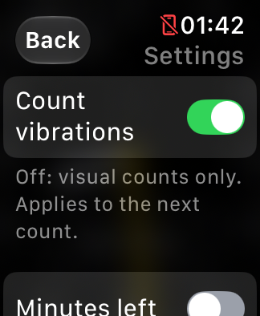 | 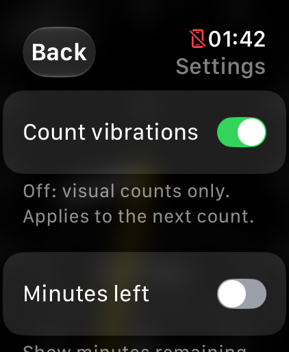 |

| Teaching face | Vibrations disabled | Largest text |
| --- | --- | --- |
| 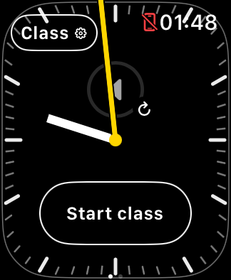 | 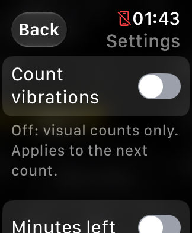 | 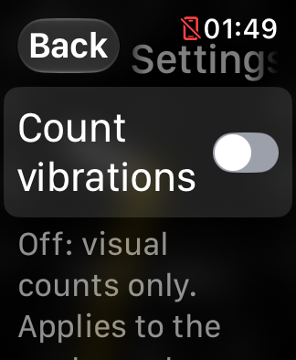 |

## Verification and limits

- Debug watchOS Simulator build succeeds; 12 Swift test suites and 80 Python
  tests pass. Final rebuild includes the retained count-result summary.
- Installed and rendered on existing SE 3 and Ultra Simulators. The SE 3 scrolls
  to the second setting; Ultra displays both switches together.
- Changed both preferences through Simulator input; checked persisted values.
  Disabled vibrations remained off after process relaunch. Largest accessibility
  text wraps the Count vibrations label without truncating it.
- Simulator interaction was intermittent during the Back/navigation check;
  no reliable end-to-end menu navigation result is claimed from those taps.
  The settings presentation can also be opened with Debug-only `--show-settings`.
- Actual haptic suppression and paired-iPhone Crown response require physical
  validation; no physical device was used in this pass. Existing tested count
  configuration and native-volume focus code are unchanged.

## Build 27: Help, Privacy and About

November 1, 2026. Read-only destinations were added below the two existing
settings. They push onto the current navigation stack; native Back returns to
Settings, whose Back still preserves the original class menu or draft.

- **Help:** clock hands/end marker, suggested/custom schedules, session versus
  class, count/vibration semantics, reopening and media/volume recovery choices.
- **Privacy:** offline explanation of local data, bounded journal retention,
  removal and voluntary sharing, plus the complete bundled privacy policy. No
  new data collection or automatic diagnostic upload was introduced.
- **About:** running version/build read from the app bundle, the complete MPL 2.0
  license and source/support website pages with an address and QR code. The full
  policy and license are copied from the repository originals at build time.

The new pages have no class/runtime/count/volume controller dependencies. The
main face, session renewal, count scheduling and native volume-focus adapter
were not changed. Native row backgrounds make the three Settings destinations
look actionable without changing their hit areas or navigation.

| Settings destinations | Help | Privacy | About |
| --- | --- | --- | --- |
| 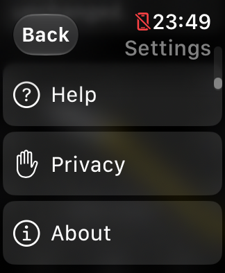 | 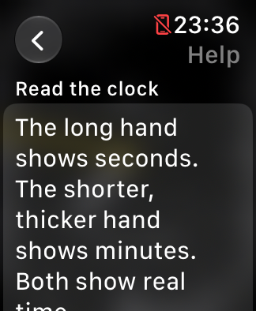 | 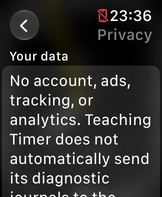 | 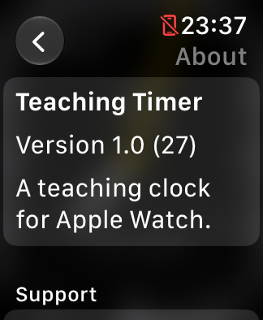 |

| Full offline policy | Full offline license | Source website QR |
| --- | --- | --- |
| 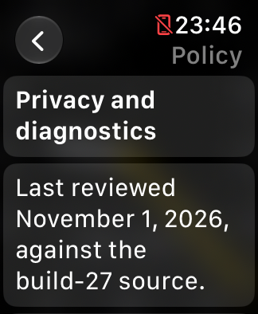 | 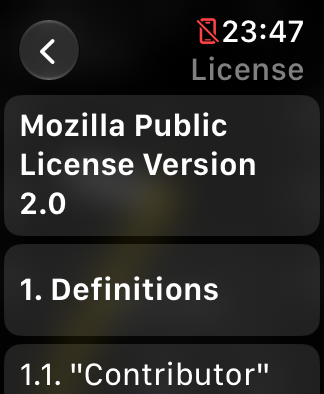 |  |

These are development Simulator captures, not final App Store screenshots.
The earlier build-25 captures above retain their original meaning and dates.

| Maximum accessibility text on SE 3 | Help on Series 12 | Help on Ultra 4 |
| --- | --- | --- |
| 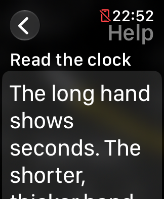 | 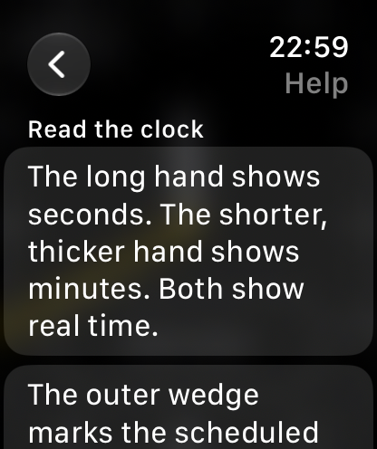 | 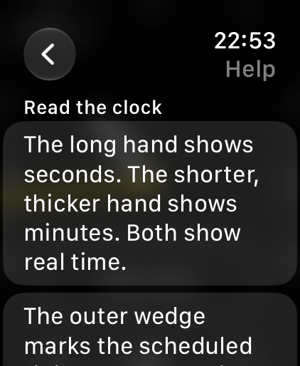 |

Verification on Xcode 27.2/watchOS 27.2:

- All 12 Swift suites and 87 Python tests, repository validation, Simulator build
  and unsigned development/distribution archive rehearsals passed.
- All 21 SE 3 action assertions passed: the retained 15 teaching-action checks
  plus each new page before and during class. Checks include rendered content,
  native Back, unchanged saved class timing and no new runtime Start/Stop request.
- The action run created only one native volume-control instance. Focus requests
  continued, but callbacks do not prove physical Crown ownership or phone volume.
- SE 3 maximum accessibility text: all three pages opened, scrolled and returned
  without horizontal truncation in the inspected frames. The final navigation-row
  background refinement was separately rebuilt and visually rechecked.
- An initial native web-link implementation displayed “URL failed to load” /
  “This URL can be viewed on your iPhone”, even with the existing simulated pair
  connected. Directly opening the same privacy URL in that iPhone’s Safari
  succeeded. The final app removes that failing browser-launch path: complete
  policy/license documents open locally; website pages show a readable address
  and QR code. No phone companion or network dependency was added.
- Build checks decode all three QR assets against their configured destinations
  and reject missing policy/license/website resources in build-27+ artifacts. The
  built policy and license were also compared byte for byte with their originals.
- The first QR screen check caught a resource-loading error: watchOS's named-image
  lookup did not display PNGs from the bundled folder. The final view loads each
  PNG explicitly with ImageIO and places the code first, above instructions.
- All 16 final nested-page assertions passed on SE 3: full policy/license opening,
  scrolling and Back; source/support/privacy website navigation and Back; and QR
  decoding from actual displayed screenshots for all three expected addresses.
  Physical camera scanning remains a pilot check, not a Simulator claim.
- One final action run failed to open the class menu before looking for Settings;
  the bounded retry passed all 21 assertions and was retained separately. An earlier
  Series OCR timeout also passed on retry. These are incomplete automation attempts, not app passes or
  evidence of a diagnosed app defect.

No physical Watch was installed or launched in this pass. Last confirmed physical
build remains 25. Signed upload, private support, TestFlight journal access,
runtime-use guidance and the physical release matrix remain outstanding.
