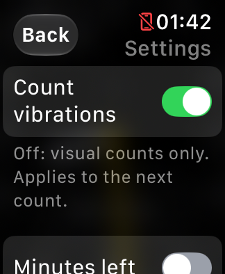
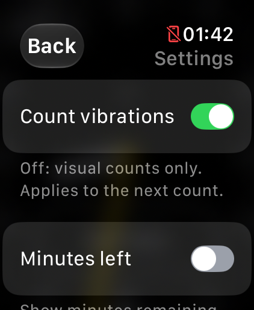
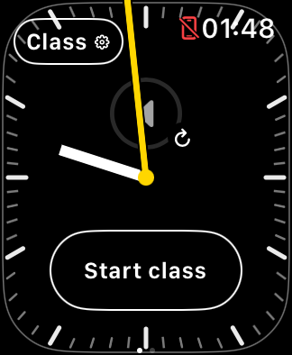
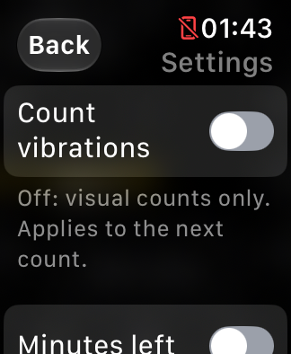
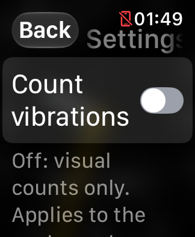

# Settings — build 25

October 30, 2026. Simulator UI pass; not installed during that pass.
Later that day build 25 was installed and version-verified; physical validation
remains pending. See [current status](../DEVELOPMENT_STATUS.md).

## Design

The teaching face keeps the word **Class**, with a gear replacing the chevron.
The menu still manages class timing; a gear alone would hide that purpose.
A **Settings** action is available before starting a class and in the active
class menu. Back returns to the appropriate class menu.

- **Count vibrations**: existing preference, on by default. Off makes subsequent
  counts visual-only, including no activation acknowledgement. An already active
  count retains its configuration until it ends or is cancelled.
- **Minutes left**: existing preference, off by default. Shows the optional
  remaining-minutes label on the teaching face.

Both persist across launches and classes. Music and system alerts are unaffected.
No new scheduling, runtime, native-volume or media behavior was introduced.
The previous count-result message remains in the class summary.

## Screenshots

| SE 3 40 mm | Ultra |
| --- | --- |
|  |  |

| Teaching face | Vibrations disabled | Largest text |
| --- | --- | --- |
|  |  |  |

## Verification and limits

- Debug watchOS Simulator build succeeds; 12 Swift test suites and 80 Python
  tests pass. Final rebuild includes the retained count-result summary.
- Installed and rendered on existing SE 3 and Ultra Simulators. The SE 3 scrolls
  to the second setting; Ultra displays both switches together.
- Changed both preferences through Simulator input; checked persisted values.
  Disabled vibrations remained off after process relaunch. Largest accessibility
  text wraps the Count vibrations label without truncating it.
- Simulator interaction was intermittent during the Back/navigation check;
  no reliable end-to-end menu navigation result is claimed from those taps.
  The settings presentation can also be opened with Debug-only `--show-settings`.
- Actual haptic suppression and paired-iPhone Crown response require physical
  validation; no physical device was used in this pass. Existing tested count
  configuration and native-volume focus code are unchanged.
