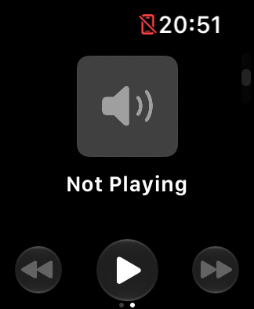
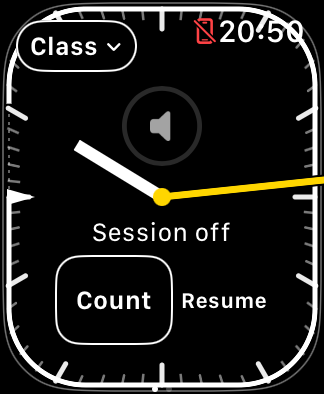
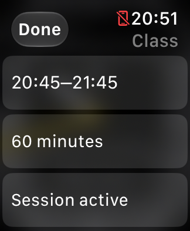

# Media-page recovery attempt and class persistence

**October 24 update:** a later, deliberate native view-service termination
reproduced black **media** content twice; host force-close/relaunch restored it
both times and preserved class timing. See the
[service-loss reproduction and Apple Feedback FB25305069](NOW_PLAYING_SERVICE_RECOVERY.md).
The October 22 observations below remain a historical record; build 6 now
automatically recovers runtime after relaunch unless the user intentionally
stopped it.

For the original failing sequence and the distinction between a blank timer
return and the physical black-media report, see the
[historical reconstruction](BLANK_PAGE_RECONSTRUCTION.md).

October 22, 2026. Source revision `61792db`, clean Debug Simulator build.
Xcode 27.1 (27A9275), watchOS 27.0, existing SE 3 40 mm Simulator, no paired
iPhone Simulator or real playback source. Device was initially shut down and
booted for this attempt. No Simulator reset/erase or media-service restart.

## Observed sequence

1. Build and install succeeded. Launch with `--show-now-playing` displayed
   native Not Playing, speaker artwork, and transport controls.
2. Actual Device Hub mouse swipes returned to the timer. Tapped Start class and
   confirmed the standard class through the UI: 20:45–21:45, 60 minutes.
   Runtime-start callback confirmed it was running.
3. Repeated swipes in both directions, with runtime active, continued to render.
   Controls → Lock produced `luminance_changed = true` in the journal. Paging
   while reduced-luminance and after unlock still rendered both pages.
4. Captured the saved ClassContext, then terminated **TeachingTimer only** using
   `simctl terminate`. Relaunched normally, without a page-selection flag.
   TeachingTimer's PID changed; NanoNowPlayingViewService's PID did not.
5. The timer rendered with its end marker/progress and **Session off / Resume**.
   Saved ClassContext bytes were identical before and after termination,
   including scheduled start, duration, and original Start timestamp.
6. Tapped Resume. A new runtime-start callback arrived. Saved ClassContext
   remained byte-for-byte identical; the class sheet displayed the original
   20:45–21:45 / 60 minutes and Session active.
7. Additional round trips and Lock from the timer continued to show native
   Not Playing and transport buttons. No all-black content page was observed.

## Conclusions and limits

- **Class persistence across process termination and normal relaunch passed.**
  Runtime is separate and needs Resume after a fresh launch. This does not test
  force-close gestures on physical hardware, nor the retirement grace boundary.
- **Black-page recovery remains untested:** the previously observed failure did
  not recur during this attempt. A healthy page before and after relaunch is
  not proof that relaunch fixes a black page, and does not contradict earlier
  Simulator captures or physical reports.
- Simulator logs contain native view-service, symbol, and unavailable-audio-
  context warnings while the page visibly works. They do not identify a cause.
- No actual audio/Crown routing was validated. No media/focus code change is
  justified by this run; none was made. No physical Watch install or launch.
- Evidence and journal snapshots are private under
  `work/support/2026-10-22-media/simulator-recovery/`.

The physical Watch unified-log attempt after the user restarted and checked
developer pairing again returned **Device not configured (6)** after administrator
authentication. Only one additional collection attempt was made. Existing app
journal/crash retrieval and iPhone unified-archive results remain separate.
