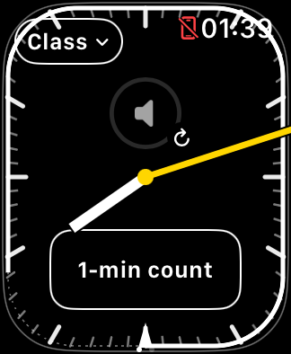
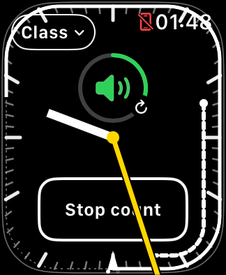

# Native volume focus after Home return

Filed October 26 as **FB25329167**, with source comparisons, Simulator captures,
and focused physical logs. See [Apple feedback status](APPLE_FEEDBACK.md).

On October 25, 2026, the SE 3 Simulator reproduced the **input/visual-feedback**
part of the build 12 physical-Watch report. It did not establish actual paired
iPhone volume, route, or audibility. Build 13 avoids the reproduced failure by
retaining the native volume widget across background setup and manual refresh.

## Environment and input

- Xcode 27.1 (27A9275), Device Hub, watchOS 27.0 (24R362).
- Existing Apple Watch SE 3 40 mm simulator; its paired iPhone simulator stayed
  shut down. No audio fixture or physical device was used in this comparison.
- Baseline: build 12, commit `a75cacdf2647293adaf35d2743fb96a3f8f6bb3f`.
- Crown input: place the pointer over the simulated Crown and scroll, as
  described in [Apple's Device Hub interaction guide](https://developer.apple.com/documentation/xcode/interacting-with-your-app-in-device-hub).
  Repeat the same input in both directions after each transition.
- Observe the native ring changing level and showing green adjustment feedback.
  This is a visible native response, not a measurement of any phone's volume.

## Baseline sequence and result

1. Build/install/launch build 12, wait for initial volume setup, and rotate the
   simulated Crown. The native ring responds in both directions.
2. Start a class. Visit media and return to timer; Crown feedback still works.
3. Press Device Hub's Home button. Wait briefly, then reopen TeachingTimer
   without terminating its process. Wait for background volume setup to finish.
4. Repeat the Crown input. The ring stays gray and does not change level.
5. Tap refresh on the timer's volume control, wait for its focus callback, then
   repeat Crown input. The ring still does not respond.
6. Swipe to media and back. Repeat Crown input: the native ring responds again.

The journal confirms a native widget replacement at background setup and another
at manual refresh. The subsequent media round trip restored feedback on that
same replacement widget. Focus calls had returned even when the ring was not
responding; a successful void API return is not evidence that Crown focus works.

In this run, background replacement was recorded at 01:38:50 PDT, manual
replacement at 01:39:09, and the media round trip at 01:39:17–01:39:19.
These timings describe the observed run, not required delays for reproduction.

## Controlled comparisons

| Variant | Change | Result |
| --- | --- | --- |
| Build 12 baseline | Replace the widget on background return and refresh | Home return loses feedback; refresh does not repair it; media round trip restores it. |
| First experiment | Keep background replacement, but refresh calls resign/focus on that same affected widget, 250 ms apart | Refresh still does not restore feedback. |
| Second experiment | Keep the original widget across background return and refresh; cycle focus on it instead | Feedback survives Home return and a journal-confirmed refresh tap. |
| Final build 13 | Clean implementation of the retained-widget approach | Passed the repeated sequence below. |

The comparison implicates widget replacement or its interaction with native host
focus. It does **not** establish watchOS's internal cause, nor prove that every
physical unavailable-volume or muted-audio incident has the same cause.

## Build 13 verification

The final run checked initial Crown response, two Home/reopen cycles, a confirmed
manual refresh, media/timer paging, and Device Hub Lock/unlock. Crown feedback
worked after each transition. Reduced luminance was recorded as true during Lock
and false after unlocking; the dim screenshot is not used to judge the green
adjustment color.

One native `controlID` remained throughout. Background/manual focus cycles ran
after approximately 262–263 ms against a requested 250 ms wait. The ordinary
media-to-timer focus call had no requested delay and executed about 8 ms after
the request. That is API scheduling time, not audio-command latency.

The persisted class kept its original Start timestamp, 60-minute duration, and
01:30–02:30 scheduled interval. The existing runtime recovery handled both Home
returns. A single landmark run spanned the navigation and dim/wake checks,
submitted all 21 timing pulses plus its acknowledgement, and completed all six
groups at about 64.81 seconds without a late-haptic cancellation. These are
submission/journal observations, not physical haptic delivery measurements.

All eleven deterministic check suites passed, including request supersession,
removal guards, interrupted focus cycles, immediate media return, and no repeated
focus calls on ordinary clock renders. Simulator and signed watchOS device
builds succeeded. No physical Watch installation was performed for this test.

## Implementation and remaining validation

Build 13 removes `.id(generation)` from the native volume representable. The
counter now identifies focus requests, not native widget replacements. It keeps
the one-second startup/background staging and follows background/manual requests
with `resignFocus()`, then one guarded `focus()` after 250 ms. Ordinary page
returns retain their immediate next-main-queue focus call. The `.companion`
origin, native UI, class/runtime/count behavior, and media reload policy stay
unchanged. See [recovery behavior](VOLUME_CONTROL_RECOVERY.md) and
[journal interpretation](INTERFACE_DIAGNOSTICS.md).

On the physical Watch, repeat Home/reopen and refresh while iPhone music is
playing, then verify both native feedback and audible volume changes. Also check
the reported no-media startup case. The Simulator test cannot resolve the
separate native endpoint-unavailable or unexpected-silencing incidents.

Paired Simulator audio discovery remains a separate open investigation
(`FB25294079`). A working native paired-media baseline would be needed to test
actual iPhone-volume commands in Simulator. It is not needed to reproduce the
native ring/focus failure above.

Raw journals, unified logs, action timestamps, experiment patches, and all
screenshots remain in the ignored local directory
`work/support/2026-10-25-simulator-focus-repro/`. Only the two app screenshots and
this bounded account are published; raw device diagnostics remain private.
