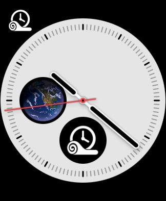
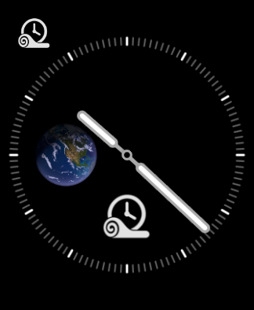
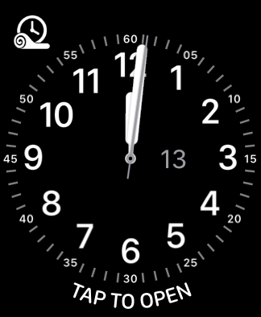
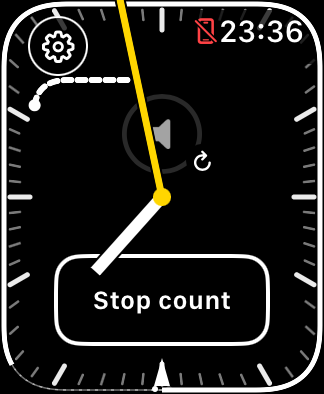
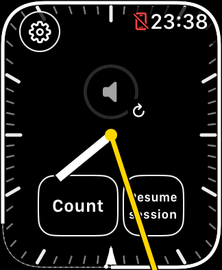
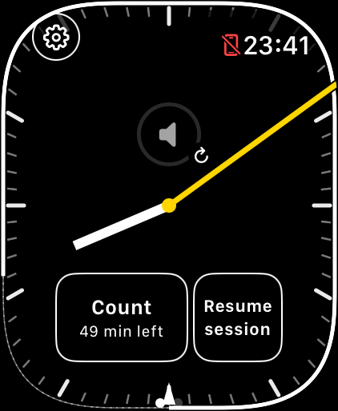

# Read the teaching face

Start a class, check the suggested schedule, and try phone volume before teaching.
The clock hands always show real time; a class does not reset them.

## Quick launch from a watch face

Maintainer TestFlight build **261113.0211.55** adds **Teaching Timer** as a
complication. Check [current status](../DEVELOPMENT_STATUS.md) for distribution
and physical-test limits. For the TestFlight version, choose the
**Teaching Timer Beta** group in the Watch's complication picker.

1. Open Teaching Timer on the Watch once after installing the updated build.
2. Press and hold your watch face, tap **Edit**, and choose **Complications**.
3. Select a supported slot and choose **Teaching Timer**, then finish editing.

Tap the complication to open the app. This does not start a new class, reset its
schedule or request a session independently of the app's normal recovery logic.
It supports circular, corner, inline and rectangular layouts; each watch face
decides which slots are available. The complication is a static launcher rather
than a live class timer, so it does not need access to saved class data or regular
timeline refreshes.

Maintainer TestFlight **261113.1031.57** replaces the generic timer symbol from
build 55 with a monochrome rolled mat and clock. The artwork follows the app icon, with broad
hands/rim and an open mat curl rather than gradients or small ticks.

November 13, 2026: SE 3 40 mm Simulator, watchOS 27.2. The new corner and circular
glyphs render in awake and dimmed states. The [rectangular slot](images/complication-2026-11-13/se3-mat-clock-rectangular.png)
also renders correctly. The smaller [inline glyph](images/complication-2026-11-13/se3-mat-clock-inline.png)
is a compact brand cue beside the app name, including [under Lock](images/complication-2026-11-13/se3-mat-clock-inline-dim.png);
the mat curl and hands are clearer in corner/circular slots. Tap-to-open keeps
class timing intact. Simulator inspection does not establish physical-Watch
readability. See
[artwork and reproduction notes](design/complication-glyph/README.md).
### Teaching Timer and native Now Playing together

For direct launchers to both apps, use the **Utility** watch face:

- **Top Left → Teaching Timer** (the mat-and-clock icon).
- **Bottom → Now Playing** (the long curved slot).

Both taps were verified on SE 3 40 mm / watchOS 27.2 Simulator: the top-left
launcher opened Teaching Timer, and the bottom launcher opened Apple's standalone
Now Playing app, not Music. The owner subsequently confirmed this setup works on
the Watch. Native Now Playing showed **Not Playing** in the Simulator without an
active media source; this test establishes launch behavior, not paired playback.

The slot matters: Now Playing was offered in Utility's bottom picker, not its
upper picker. Infograph does not offer the same native launcher. Keep Infograph
and add Utility as a separate teaching face if preferred; no app update is needed
for the layout once the Teaching Timer complication is installed.

## Dial and controls

November 5, 2026 interface refinement: SE 3 40 mm Simulator, watchOS 27.2,
Xcode 27.2. The local development artifact is build **41**, source
`683886f9491e-dirty`, built November 5 at 23:34:26 PST
(`2026-11-06T07:34:26Z`). Its uncommitted changes included this interface refinement
and the compiler callback fix. This is not a released TestFlight build.

This is a simulated class. The red crossed-phone symbol is watchOS's
disconnected-phone indicator; this image does not demonstrate working paired
audio. The visual key below explains the image without covering the hands or
controls. See [current status](../DEVELOPMENT_STATUS.md) for later source/build
evidence; the externally available beta may be an earlier build.

| Where to look | What it means / what to do |
| --- | --- |
| **Gear ⚙**, upper left | Opens the class menu and Settings. Edit the current schedule, stop/resume its session, or explicitly begin/end a class. |
| System time, upper right | watchOS supplies the digital time. The dial continues behind it and the gear button. |
| Long, thin hand (yellow here) | Real-world seconds, ticking once per second when watchOS permits. |
| Short, thick hand (white here) | Real-world minutes, including the current second's fraction of a minute. Its thickness distinguishes it in monochrome. |
| Outer bright perimeter | For a 60-minute class, the time still ahead, clockwise toward the scheduled finish. Past time has less visual weight. A 75-minute class keeps its finish marker but omits this single-revolution progress line. |
| Inward wedge | Scheduled class finish. It is visible from the start and grows modestly halfway through the scheduled interval. |
| Speaker ring and small refresh arrow | Turn the Crown to change the **paired iPhone's** media volume. Tap the ring to request a refresh if it stops responding. Visual feedback alone does not confirm audible volume changed. |
| **Stop count**, lower center | A one-minute count is active. Tap to cancel. When inactive it reads **1-min count**; without a class it offers **Start class**. |
| Small inner dot/arc | Time since the count tap, independent of the wall clock. It starts at the tap's clock position and grows for 60 seconds; a clock correction does not restart it. |
| **Start session** or **Resume session**, when shown beside Count | Requests the session that supports wrist-down updates. Class timing and the count stay independent. |
| Two dots, bottom | Two swipe pages: the teaching face and Apple's native media controls. |

## Three independent things

**Class schedule** is the saved start, duration and finish. Default Start uses a
60-minute class and the suggested quarter-hour. Before the last two minutes of
a quarter-hour, the suggestion uses the preceding boundary; at `:13` or `:14`
it uses the next. Check that suggestion when opening early or late. Custom
schedule changes only this class.

**Session** is the mindfulness runtime that helps keep the app available and
the clock updating wrist-down. **Stop session** leaves the class intact.
**Start session** or **Resume session** requests a session without changing the
class schedule.
An intentional Stop stays stopped after reopening; reopening can recover a
session that was meant to run. **New class** and
**End class** are separate, confirmed actions. An old class clears 30 minutes
after its scheduled end; the next class never starts silently.

**Count** measures time from its own tap. Vibration groups of 1–6 begin at
10, 20, 30, 40, 50 and 60 seconds. The inner arc fills at 60 seconds and remains
while the final group finishes, normally around 64.8 seconds. This brief hold
also occurs with vibrations disabled. Late or skipped haptics do not erase the
arc. **Gear → Settings** controls count vibrations and optional minutes remaining.

## When the session stops

The separate recovery button says **Start session** when this app launch has
not recorded a successful session start, or **Resume session** after one has run.
Either requests wrist-down support without restarting class timing or a count.
The gear menu explains the session under **Wrist-down updates**; it also shows
the session's current status. An explicit Stop stays stopped until you request
a session again. A **Start session** label after reopening does not mean your
class schedule was lost.

| SE 3 40 mm | Ultra 49 mm, maximum text |
| --- | --- |
|  |  |

These are Simulator captures of the same interface refinement, not physical
haptic, Crown-volume or Always-On verification.

## Music during teaching

The timer targets the iPhone; native Now Playing can instead show Watch music.
Check the source before class. Swiping to media and back restores timer Crown
focus in reported cases. If the timer volume ring is unresponsive, tap it once
to refresh and give it a moment before trying the Crown again.

Native song progress can still freeze even when Pause and volume work. Swipe
away and back to refresh its position; it can stall again. Eligible longer
wrist-down intervals also trigger a bounded refresh on wake. Use audible music
as a cross-check before timing a pause to the end of a song.

If playback continues silently, use the iPhone's volume controls; avoid repeated
blind Crown adjustments. These are recovery steps, not guarantees. See the
[first-class guide](TESTER_GUIDE.md) for setup and [support](../SUPPORT.md) for
reporting an incident after class.
