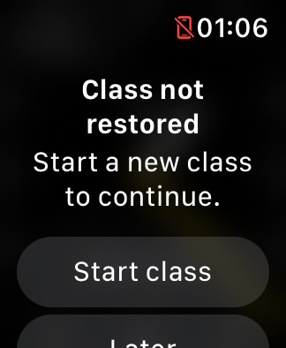
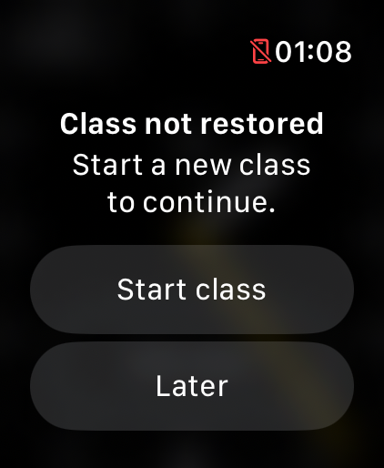

# Usability follow-up — builds 20–21

October 28, 2026. Build 16 remains on the physical Watch. No physical queries,
installs, launches or log collections occurred during this work.

## Implemented

**Build 20:** timer volume retains its refresh arrow and briefly outlines it to
acknowledge the attempt. Accessibility says “Refresh requested.” The native
widget, tap area, focus calls, timing and immediate media-return path are
unchanged. It does not claim that Crown ownership or audio recovered.

**Build 21:** an unreadable saved class shows “Class not restored” with “Start a
new class to continue.” Start class opens the normal draft; Later returns to the
face. Acknowledgement does not erase the original data or recovery backup. A
later launch warns again until explicit replacement/reset. A fresh installation
or valid restored class has no warning. Diagnostic-event draining does not hide
the notice. The warning is about unreadable class data, not ordinary retirement
or an expired mindfulness runtime.
The notice temporarily relinquishes timer-volume focus so the system alert can
use the Crown. Ordinary timer/media return keeps its existing focus path.

| SE 3 40 mm | Ultra 4 49 mm |
| --- | --- |
|  |  |

These are original Simulator captures with deliberately invalid test data.
On SE 3, Start class is visible immediately; Later is below and reachable by
scrolling. Native alert presentation follows system text sizing. Earlier longer
wording pushed the primary action offscreen and was shortened before completion.

## Evidence correction

The [timer-control investigation](TIMER_CONTROL_INVESTIGATION.md) found that the
earlier missing-control screenshot interpretation was wrong. The original files
contain the controls. No reliable disappearance reproduction or production
rendering fix was established. Drawing-only timelines and compositing changes
were tested then removed. Existing hand placement and the volume adapter remain.

The [Apple media follow-up](APPLE_MEDIA_UPDATE_2026-10-28.md) was also corrected:
nine delayed captures described as black contain Not Playing. Physical reports
remain valid, but these images cannot establish the claimed delayed failure or
rank recovery variants. No new workaround was adopted from that comparison.

## Verification and remaining work

- All twelve Swift suites and 44 Python tooling checks pass.
- Simulator build and unsigned development/distribution archives pass.
- The SE 3 volume sequence passes all six host/class/control lifecycle checks.
- All 14 essential teaching-action assertions pass on SE 3, including class
  editing, Stop/Resume, count start/cancel, New/End class and media return.
- Deliberately unreadable preferences were tested on SE 3 and Ultra: notice,
  Later/data preservation, relaunch warning, draft opening, default Start and
  backup retention. The driver needed to wait for sheet presentation and
  asynchronous preference flushing; its early failed assertions were retained
  privately rather than treated as app failures.
- The modal guard was checked with fresh Ultra diagnostics: no timer-volume
  setup/focus events occurred while the notice was open; dismissal produced
  normal setup and returned focus calls. Actual Crown ownership remains a
  hardware observation, not something those callbacks prove.
- Foreground hand placement, quarter-hour suggestion, count/haptic scheduling,
  runtime recovery/intent and media policy have no intentional behavior changes.

The next useful usability work is observing real hand/label intersections and
schedule selection, plus physical accessibility and teaching validation when
available. The count-completion distinction is already explained in the tester
guide. No new face controls, numeric countdown or schedule-inference rule were
added in this pass.

Private build/UI evidence is under ignored `work/support/2026-10-28-controls/`.
Only synthetic-data Simulator screenshots are published.

The subsequent [build-22 pass](USABILITY_PASS_22.md) completes the schedule-cue,
hand-label comparison and Simulator text-size audit; physical gates remain.
