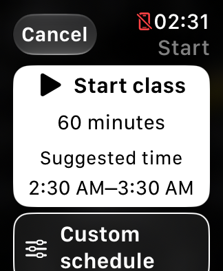
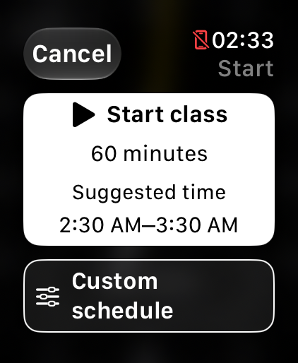
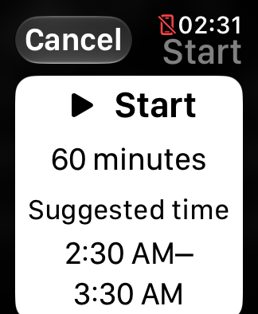
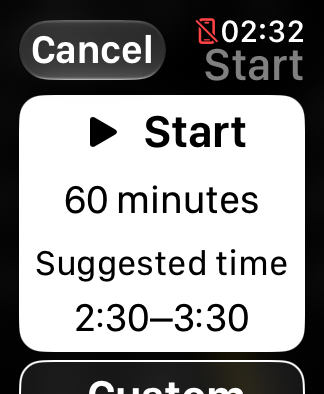

# Usability pass: candidate build 22

October 28, 2026. The physical Watch remains on teaching build 16. This pass used
the two disposable SE 3 40 mm and Ultra 4 49 mm Simulators only.

## Changes retained

- The default class card now says **Suggested time** above its start/end
  interval. The same cue is included in its accessibility value. The default
  stays 60 minutes; quarter-hour inference and custom drafts are unchanged.
- The secondary cue stays on one line and may scale modestly at larger text
  sizes. Actual start/end text still grows and wraps. An initial unconstrained
  cue wrapped to two lines at maximum size and pushed the interval down; that
  trial was tightened before acceptance.
- Action labels allow two lines with modest scaling, avoiding three-line
  fragments such as “sched- / ule” at maximum text size. Full accessibility
  names and the existing touch areas remain.
- The face's Start button explicitly announces **Start class**, including
  when its visible large-text fallback is shortened to Start.

No changes to native volume/focus, media refresh policy, runtime renewal,
class persistence, count/haptics, hand meaning, hand stacking or dial geometry.

| SE 3, normal text | Ultra, normal text |
| --- | --- |
|  |  |

| SE 3, maximum text, 12-hour | SE 3, maximum text, 24-hour |
| --- | --- |
|  |  |

Original Simulator captures use synthetic classes. The 12-hour range wraps on
the small display; both times remain visible in the initial card. Custom
schedule and longer settings need scrolling at maximum text, which preserves
legible type and large targets. The action-label follow-up keeps schedule labels within two lines. Explanatory
text remains free to wrap; destructive actions stay secondary. Neither hands
nor touch targets were reduced to save space.

## Hand/label comparison

A private, temporary Simulator build fixed the wall-hand inputs to four selected
angle combinations and forced an awake or monochrome appearance. It compared
the current count label with a small stop/timer icon plus shifted text. The
fixture is not a wrist-down timing test and was removed from production source.

Thirty-two frames were retained across both sizes. Outline measurements found
the full button sides in all 32. Six early fixture frames did not yet show the
requested angle/color; a pixel ray check excluded them from the angle comparison.
Ten matched baseline/candidate pairs remained. Adding an icon did not consistently
make the text clearer: it changed which letters the hands crossed and consumed
width on SE 3. No icon, text displacement or hand-masking change was adopted.
The button remains generous and both hands stay foremost. Actual glance
readability while teaching still matters more than OCR recognition.

## Layout and accessibility audit

- Setup/custom-schedule flows were captured at normal and maximum text in
  12/24-hour formats on both sizes: 52 retained frames. Format was checked in
  recognized text; passing a launch argument alone was not accepted as proof.
- Class summaries were also checked in both time formats at maximum text,
  including the schedule, Stop session, Edit/New class, count/display settings
  and End class reached by scrolling.
- Only the disposable Simulators' locale/hour preferences were changed for
  testing. Their original values were restored. Early driver attempts exposed
  an ambiguous wrapped-text target and a preference-restore syntax error;
  those attempts are retained privately, corrected and not reported as app bugs.
- The source audit retains full names for Class options, count start/stop,
  Resume session, earlier/later start adjustments and iPhone playback volume.
  Native volume has an accessibility refresh action without adding Crown
  bindings. The added face Start label removes the ambiguous fallback name.
- Existing layout checks cover eight Watch geometries, minimum 44-point
  action targets and the count track staying clear of controls. Simulator
  OCR/layout checks do not establish physical VoiceOver navigation, Crown
  ownership, tactile delivery, wet-finger accuracy or dim-room readability.

## Verification

Twelve model/controller suites and 48 Python checks pass. The Debug Simulator
build and unsigned development/distribution archive rehearsals pass. The final
accessibility and wrapping additions were included in a fresh full rehearsal. All 14 essential-action assertions pass on each size, and all six
focus/lifecycle assertions pass on SE 3. Four final media captures contain Not
Playing; start/cancel captures retain both count-button outline sides. These checks never install on a physical device.

Private experiment sources, PNGs, OCR, ray/outline measurements, preference
restoration records and logs are under `work/support/2026-10-28-next-pass/`.
Remaining physical and distribution gates are in the [active roadmap](ROADMAP.md).
