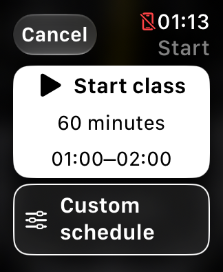
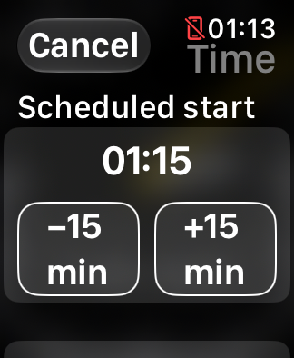
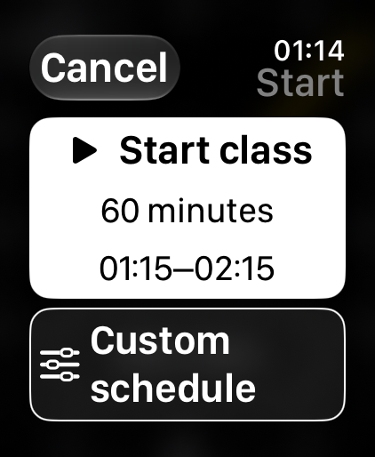
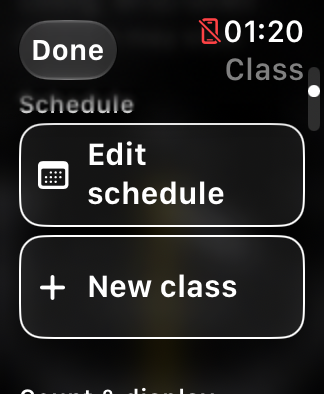
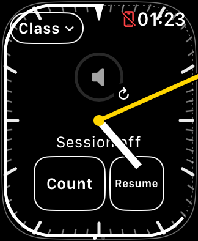

# Teaching usability review — October 26, 2026

This is the historical Simulator review. Build 16 was subsequently installed
and launched; see [current status](../DEVELOPMENT_STATUS.md) for deployment and
the maintainer’s later physical usability feedback.

Build 15 follows build 14's separate haptic experiment. The priority is a teacher
making short, one-handed interactions while watching a class. No physical Watch
was used, installed, or contacted in this pass. The physical Watch remains on
build 12; build 13's volume-focus mitigation still needs physical testing.

## Review and changes

| Essential task | Finding and disposition |
| --- | --- |
| Start the usual class quickly | Read-only summary rows and actions looked similar. The default 60-minute start now has a solid white surface, play icon, and visible interval. Compact layouts use “Start”; the accessibility label remains explicit. |
| Recognize secondary actions | Edit schedule, New class, Custom schedule, Reload media, and time adjustments now have outlined touch surfaces and icons where useful. Geometry provides the distinction in monochrome. |
| Correct a suggested start | The time is on its own row above two generous ±15-minute actions. Existing quarter-hour inference and 60/75-minute options are unchanged. |
| Enter the schedule editor | A scrolled Class menu carried its offset into the editor, sometimes opening near Reload media. Changing editor mode now resets only the Form's identity/scroll position. Shared state and native media controls are unaffected. |
| Leave without modifying timing | Draft screens say Cancel; the summary says Done. Custom edits affect only that class. Default schedule restores the original suggestion. Saving dismisses the sheet. |
| Recover a stopped session while teaching | Stop/Resume is the first action after class information. Resume has a solid primary treatment in the menu and an outlined, padded touch target on the face. Either menu action returns directly to the face. |
| Avoid accidental class loss | End class remains separate and confirmed. New class still confirms replacement. Neither is given the primary visual treatment of Start/Resume. |
| Trigger/cancel counts | The existing large count target remains. Label padding prevents crowding; compact labels/icons remain available. Count state, arc geometry, and cancellation remain shared. |
| Read the clock in motion | Both hands, major ticks, and end wedge stay foremost and unchanged. A hand temporarily crossing a label is an intentional consequence of the requested hand priority, not solved by hiding the hand. |
| Recognize class progress | The 60-minute perimeter and persistent end wedge remain. A 75-minute class still omits the ambiguous one-hour progress arc. No new countdown is enabled by default. |
| Control music | Native volume and its focus implementation are untouched. Native media remains the second page. Simulator page/focus events establish lifecycle behavior, not working iPhone audio. |
| Use large text | Start adapts to a short label. Sheet titles are Class, Start, or Time; the longer titles clipped on the small Watch with maximum text. Multiline action labels grow vertically rather than truncating. |
| Understand late vibrations | Build 14 no longer disables the run on a late pulse. The menu explains that watchOS can delay vibrations. Full timing and skipping rules are documented separately. |
| Access diagnostics/settings | Count vibrations, optional minutes left, and media recovery remain secondary, away from the main teaching controls. No extra diagnostic status was added to the face. |

The class/action/Resume touch shapes now live inside their button labels, so the
generous frames define the interactive region rather than only surrounding it.
The same shared style distinguishes action rows without depending on color.
Existing minimum 44-point targets and accessibility labels are retained.

## Simulator verification

Xcode 27.1 (27A9275), watchOS 27.0, existing simulators. The setup layout was
captured across all eight available models:

| Model | Sizes checked |
| --- | --- |
| Apple Watch SE 3 | 40 mm, 44 mm |
| Apple Watch Series 9 | 41 mm, 45 mm |
| Apple Watch Series 12 | 42 mm, 46 mm |
| Apple Watch Ultra 2 | 49 mm |
| Apple Watch Ultra 4 | 49 mm |

After the final title/adaptive-label refinements, default and maximum-text setup,
custom-time, and teaching-face captures were repeated on SE 3 40 mm, Series 12
42 mm, and Ultra 4 49 mm. A final Resume-padding adjustment was checked on the
small SE. Maximum text uses the existing DEBUG environment flag, now explicitly
applied to the presented sheet too; `simctl ui content_size` is unsupported for
this Watch runtime. This is an app-environment check, not a system accessibility
configuration or VoiceOver test.

SE 3 interaction evidence:

- Edge taps open Class and activate Resume. Stop and Resume dismiss the sheet,
  preserve class context, and produce the expected session state.
- Opening Edit schedule after scrolling starts at Scheduled start.
- A +15-minute draft followed by Cancel leaves persisted class timing unchanged.
- A +15-minute draft followed by Save changes the persisted start by exactly
  900 seconds and retains the original initial-Start timestamp and running intent.
- Native Now Playing renders its empty-source controls. Returning to the timer
  records focus request/call/return for the retained native control. No paired
  iPhone volume or audible output is established by this test.
- All eleven deterministic suites pass, including schedule/persistence, runtime,
  focus, count cancellation/restart, and eight-size layout/geometry checks.
- Debug and Release Simulator builds succeed. No signing/install experiment was
  performed on physical devices.

For the separate build 14 change, a locked Simulator count submitted all 21 timing
pulses, including 15 classified late, and completed all six groups. Read
[Haptic delays](HAPTIC_DELAYS.md) for timing, skipped-group behavior, and evidence
limits. The `.directionUp` pattern was not weakened.

Only the SE 3 simulator is left running. Comparison simulators were returned to
their prior shutdown state; no audio fixture was started.

## Representative actual captures

| Default Start on SE 3 40 mm | Maximum text on SE 3 40 mm | Maximum text on Ultra 4 49 mm |
| --- | --- | --- |
|  |  |  |

| Class actions on SE 3 | Session off on SE 3 |
| --- | --- |
|  |  |

## Remaining usability priorities

1. **Actual music reliability remains the most consequential issue.** Blank
   media and timer-volume unavailability/silencing have mitigations, not proven
   general fixes. Continue the separate native-control investigation; do not
   trade away the working media-return focus behavior for visual cleanup.
2. **Count trust needs a real class.** Late groups may be stretched; obsolete
   groups can still be skipped to avoid overlapping meanings. The new behavior
   avoids abandoning the rest of the count but cannot compel watchOS delivery.
   Four-to-six pulses need physical countability testing while moving.
3. **Independent silent strong haptics are not established.** The public API has
   no separate sound switch, and Device Hub currently has a documented None-output
   selection bug. See [Device Hub testing](DEVICE_HUB_TESTING.md).
4. **The dim-transition hand backstep remains.** The minimal clock probe makes a
   separate Apple report and comparison on a newer Watch runtime the next useful
   step. There is no speculative production hand change in this pass.
5. **The quarter-hour suggestion still deserves observation.** A teacher checking
   early can be anchored to the preceding quarter. The interval is now conspicuous
   and correction explicit; changing inference without evidence could move the
   error elsewhere. Review the next actual confusing case before changing it.
6. **Real accessibility and environment checks remain.** VoiceOver order, physical
   Crown routing after each action, touch accuracy with sweat, dim-room glare,
   battery use, and glance readability while teaching cannot be established by
   these screenshots. Large text requires more vertical scrolling in secondary
   menus; primary Start remains first.

No additional pages, gestures, audio routing, runtime-renewal behavior, class
snapping, or clock geometry were introduced by the menu pass.
