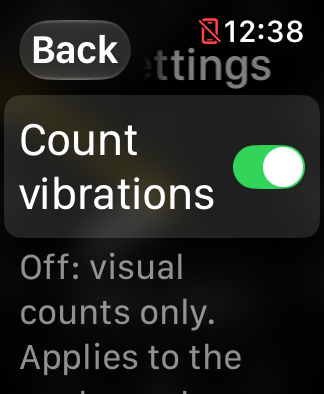
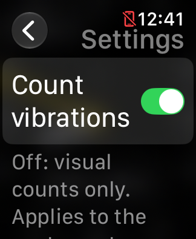
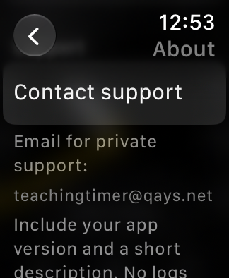
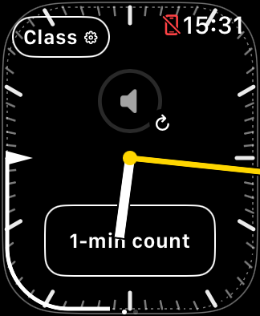
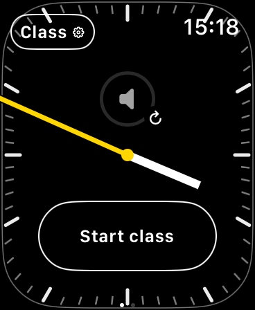
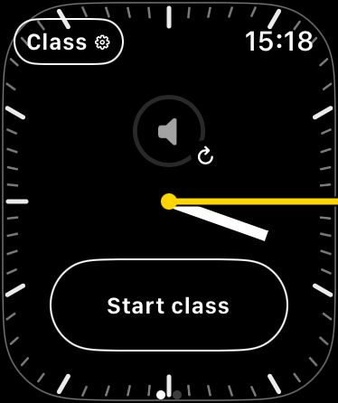
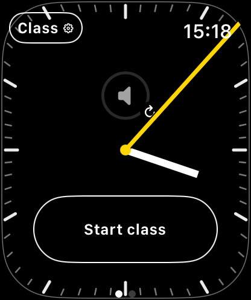
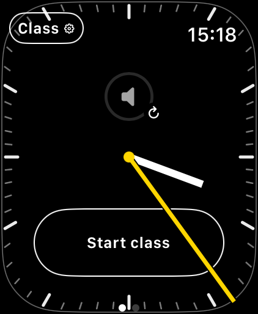
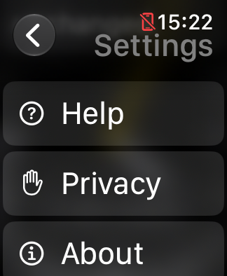
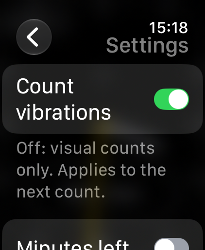

# V1 readiness review — November 2, 2026

This is the active review record. [Current verification](../DEVELOPMENT_STATUS.md)
owns the candidate and installed-build status. The initial review left the
physical Watch untouched while TestFlight preparation/upload and support setup
proceeded. The user subsequently authorized a supervised physical owner pilot;
its [dated results and remaining checks](TESTFLIGHT_PILOT_RESULTS.md) are separate
from the earlier release and Simulator evidence below.

## Scope and acceptance

Preserve the Watch-only teaching clock, shared class/runtime/count state, native
companion volume control and native Now Playing. Improve concrete correctness,
onboarding, evidence and release gaps before expanding features. A clean build
or Simulator pass does not establish physical Crown, audio, haptic, battery,
Always-On, distribution installation or App Review acceptance.

## Findings addressed

- **New Start lost during old runtime invalidation:** a deterministic controller
  reproduction showed a new class with running intent but no runtime. An explicit
  Start now waits for the previous session to finish and the app to be active.
  It is tied to its class, creates one successor and is cancelled by a subsequent
  Stop, reset, replacement or retirement. Existing automatic-renewal policy and
  native controls are unchanged.
- **Retired schedule editor silently saving nothing:** edits now check original
  class identity and retirement before saving. A retired editor becomes fresh
  setup with a short explanation; Settings returns there as well. Independent
  custom new-class drafts are preserved. Invalid saves cannot resurrect an old
  class or modify another class.
- **Release and repository checks:** test both signed payloads and the actual
  entitlement-plist parsing command. Reject force-added credential and generated
  artifact families already excluded by ignore rules. No such tracked files were
  found. Add optional, bounded retirement UI cases using pre-launch synthetic
  classes; no live preferences or system-clock changes.
- **Information copy:** About uses the real bundle display name, including Beta;
  Help explains the suggested quarter-hour; Privacy says there is no in-app
  export/upload. After the owner pilot, build 36 qualifies verified TestFlight
  copying to the maintainer's developer-enabled Watch and trusted Mac and
  discloses separate unreadable-journal recovery files outside rolling limits.
- **Documentation drift:** reconcile the accepted agreement, signed build-28
  export, newer runtime availability and continued song-progress recurrence.
  Keep dated investigations and their corrections intact.

Signed release preparation also now rejects dirty source before archiving and
rejects source/commit changes or a mismatched binary revision before export.
Unsigned rehearsals remain usable during development. Build 31's 107 Python tests pass,
including the signed-source boundaries and ignored-versus-untracked Git fixtures.

## Post-pilot Mac review

The final bounded code review traced class Save/retirement/replacement, runtime
invalidation and deferred activation, Stop priority, count cancellation during
groups five/six and fresh restart, and delayed native-focus supersession against
their existing deterministic tests. It found no new reproducible defect requiring
a local behavior change. This is not proof of native platform behavior.

The README, support guide, first-class guide, in-app information and reviewer
steps agree with those flows. The build-36 privacy corrections are verified on
the SE 3 40 mm Simulator; the [clean signed local artifact](TESTFLIGHT_PREPARATION.md#local-build-36)
is ready but not uploaded. The inspected export contains the exact committed
policy and license. Existing broader build-35 layout checks remain dated evidence.

Further meaningful release validation depends on the physical teaching and
accessibility tests, ordinary tester support path, minimum-OS execution and
review decisions listed below. No native media/volume issue is closed by this
source review, and the prepared Apple follow-ups remain unsent.

## Account and support preparation

The separate App Store Connect record is **Teaching Timer Beta**, with store
container `net.qays.TeachingTimer`. Apple rejected “Teaching Timer” as already
used; the public release name remains a decision. The Watch payload stays
`net.qays.TeachingTimer.watchkitapp`; development remains
`com.qayshp.TeachingTimer`. Build 35 is Ready to Test / Internal after clean
signed archive/export, upload and processing. It is assigned to the Maintainer
pilot with one tester, the owner, and manual distribution. Builds 29, 31, 32, 33 and 34 are also
assigned; build 30 is processed but unassigned. No external testers or public
release are configured. The build-35 What to Test notes and one-group/one-tester
assignment were verified after reload in App Store Connect.

Beta Test Information was saved and verified after reload: description and known
limitations, support address, repository and privacy URLs. Review contact remains
blank; no custom EULA or app sign-in requirement was added.

The approved support alias was added to the existing iCloud custom domain.
Existing routing and catch-all settings were retained. Incoming and outgoing
plain email were received and their contents verified November 2. Native Watch
and diagnostic attachment delivery remain unverified. See the
[private intake procedure](PRIVATE_SUPPORT_PLAN.md).

The isolated [sharing probe](../tools/diagnostic-share-probe/README.md) presented
synthetic text/JSON/ZIP to the SE 3 Simulator's native sharing UI. JSON and ZIP
reached Messages compose and triggered representation requests. Only Messages
was offered; nothing was sent. This supports a future physical file-sharing
experiment, not an implemented journal export or verified Mail/delivery path.

## Evidence and remaining checks

Selected Xcode is 27.2 (27B52), with Watch Simulator 27.2 (24S118) and the newest
compatible general iPhone runtime 27.2 (24B8117). Existing booted Simulators are
reused. The initial build-28 SE 3 action run passed all 21 assertions, including
information pages, saved timing, session/count controls, replacement, and page
navigation. Actual screenshots show the expected controls and native Not Playing
state; no paired audio result follows.

The first build-29 source checks passed all 12 Swift suites, the full build and
unsigned development/distribution archive pipeline. That build's Python suite
passed 102 tests after adding retirement fixtures and explicit export-declaration checks.
All ten SE 3 retirement assertions pass for build 29: old editor redirect,
Settings return, explicit new Start, custom draft preservation, and cleanup.
Screenshots were reviewed separately. Build 29's clean signed revision
`7e9ca4a82324` and build 30's `da9d8d6756f8` passed signed export and Apple
processing. Build 31 passes all 12 Swift suites (including new early-handoff
scene/native checks), 107 Python tests and Debug Simulator compilation. Clean
revision `9da154876eeb6a429e3d655583696b5958b8dd2b` passed signed archive/export,
including the source-cleanliness guard. Upload completed at 13:19:59 PST on
November 2; Apple processing and owner-pilot assignment are verified. Raw captures,
build products and account evidence remain
private under ignored `work/`.

Next independent work:

1. Preserve the now-completed [issue-7 comparison](RUNTIME_RECOVERY.md#build-31-candidate-comparison):
   one matched candidate trial defers the premature Start and recovers on later
   active wake without error. A second trial did not match initial dimming;
   Stop comparisons independently retained stopped intent. All 14 candidate
   preference captures matched the baseline class bytes. This is bounded Simulator evidence, not
   a guarantee for arbitrary callback ordering or physical behavior.
2. Preserve the completed [physical owner-pilot evidence](TESTFLIGHT_PILOT_RESULTS.md):
   installation/update/relaunch, limited Beta journal access and cleanup passed.
   Original journal history remains; normal stale-class retirement and unavailable
   pre-install preferences limit the preservation claim. Teaching tests remain open.
3. Preserve completed retirement/layout assertions and reviewed screenshots as
   regression evidence. These are completed UI checks, not pending redesign work.
4. Preserve the [exact-Date diagnosis and bounded candidate comparison](ALWAYS_ON_HAND_TRANSITION.md#november-2-exact-date-precision-diagnosis)
   for the existing Apple report. Build 33 corrects the exercised numerical
   boundary mechanism without globally clamping timeline dates; hardware
   validation and the Apple update remain pending.
5. Evaluate ordinary tester access separately from the successful owner
   developer-tool copies. Incoming/outgoing plain support email is verified;
   native Watch and diagnostic attachment delivery remain unverified.

The [publishing gates](PUBLISHING_READINESS.md) remain: actual runtime-use guidance,
minimum watchOS compatibility, physical teaching/accessibility validation,
release metadata and privacy review, and a small teacher pilot. Known native
media/volume defects remain separate tracked symptoms with recovery guidance;
this review has not established their root causes or closed them.

## Build 30 usability follow-up

Default setup/face captures were reviewed across SE 3 40/44 mm, Series 12 42/46 mm
and Ultra 4 49 mm on watchOS 27.2. Maximum-text Settings was checked on the small
SE 3 and Ultra. On SE 3 the custom Back capsule obscured Settings; the icon-only
chevron keeps the same return action and accessible Back label. Cancel/Done retain
their distinct text. The maximum-text custom Cancel/Time header fits unchanged.
Back returned to the same fresh setup in the targeted test.

| Build 29, maximum text | Build 30, maximum text |
| --- | --- |
|  |  |

About now provides the verified private email and a support QR. The address stays
on one line; the QR page uses the short Support navigation title. Its code was
decoded from the actual SE 3 screenshot to the configured support-page URL. Native
Back returned to About. Physical camera scanning and attachment delivery remain
unverified; the probe is still isolated and not a feature of TeachingTimer.

| Offline email | Phone support link |
| --- | --- |
|  |  |

## Build 32 bounded follow-up

Build 32 is the clean signed candidate and is available to the owner pilot.
The physical Watch remains untouched on build 25.

- **Queued explicit Start:** the readiness check now also covers an explicit
  request waiting for the previous runtime's invalidation. Deterministic
  boundary-double tests pass for both readiness/invalidation orders and for
  cancellation by Stop, reset, replacement or retirement. Injected error paths
  are synthetic tests, not a new observed Simulator rejection. Direct immediate
  Start, native media/volume and count behavior are unchanged.
- **Privacy artifact verification:** archive inspection and exported-IPA checks
  now verify the actual Watch privacy manifest against the reviewed declarations.
  The existing build-31 archive/export already passes. This closes a verification
  gap rather than a shipped privacy defect; it does not establish Apple approval
  or replace an API-usage/privacy review.
- **First-use instructions:** README and tester guide explain Beta's separate
  saved state, Start class versus session, and the arc filling at 60 seconds
  before count completion near 64.8 seconds, including visual-only counts.

Build 32 compiles for Simulator and passes all 12 Swift suites and 110 Python
tests. All 21 UI-action assertions pass; Help, active clock, Stop/Resume and native
Not Playing screenshots were reviewed without a new visual regression in those
views. Clean source `f931c173ab86` passed signed archive/export, actual Watch
privacy-manifest checks, CI, Apple processing and manual owner-pilot assignment.
See the [release artifact record](TESTFLIGHT_PREPARATION.md#subsequent-pilot-builds).
This does not establish paired audio, physical installation/update or journal access.

A source-only minimum-OS audit found all three build configurations target
watchOS 26. The used APIs checked against the current SDK were available by
watchOS 10, with no unguarded post-26 API found. This is not execution on the
minimum OS: no older runtime was installed, and watchOS 26 execution remains pending.

## Build 33 clock-boundary follow-up

An exact-reference-date probe exposed a one-representable-step boundary
mechanism behind captured backward hand inputs; rounded Unix timestamps had
hidden it. Build 33's shared display helper normalizes only immediate integer
neighbors, keeping the schedule and raw class/runtime/count state intact.
The normalized comparison corrected 113 affected inputs among 234 evaluations;
independent replay matched all records and 190 video frames over 24.283 s showed
no measured backward whole tick. All 13 Swift suites, 117 Python tests and 21
full-app Simulator UI-action assertions pass. See the
[evidence and limits](ALWAYS_ON_HAND_TRANSITION.md#build-33-candidate--bounded-simulator-validation).

Clean source `12772ccabb44b4bc93ce235f5bc94b3790c8d740` passed signed archive/export,
[CI](https://github.com/qayshp/TeachingTimer/actions/runs/41538777416), upload and
Apple processing. Build 33 is Ready to Test / Internal; its notes and one-owner
pilot assignment survived reload. Physical build 25 remains untouched, and Beta
install/update/journal checks remain open. No physical fix or universal cause
is established, and no new Apple update was sent.

## Build 34 stable-anchor integration

Build 34 combines the existing narrow precision helper with a fixed epoch
schedule after a normalized moving/fixed probe comparison reproduced two
moving-anchor backsteps and none with the fixed epoch. Full-app integration
passes all 21 UI-action assertions and a locked six-group count, completing
near 64.823 seconds with runtime running while the scene was inactive. A separate
23.815-second runtime-active recording has 764 analyzed frames and no ambiguous detections or
backward-tick candidates; reviewed original frames cover dim/wake and forward
minute rollover. See the [comparison and limitations](ALWAYS_ON_HAND_TRANSITION.md#build-34-follow-up-stable-schedule-anchor).

This is bounded Simulator evidence, not physical haptic/clock validation or a
universal fix. Clean source `ee054de666c34274d3fe200d0f69d698c50c97b7` passed signed
archive/export, [CI](https://github.com/qayshp/TeachingTimer/actions/runs/41541943839),
upload and Apple processing. Build 34 is Ready to Test / Internal; notes and
assignment survived reload, and the manual pilot has one tester/five builds.
Physical build 25 is unchanged. At this checkpoint, physical Beta checks,
outbound support delivery, Apple runtime-use guidance and final owner/review
decisions remained open. Plain support email was subsequently verified in both
directions on November 2; diagnostic attachment delivery remains unverified.

## Build 35 static layout matrix

Build 35 is also Ready to Test / Internal and assigned to the owner-only manual
pilot. Signed export, upload, notes and assignment are verified; the
[artifact ledger](TESTFLIGHT_PREPARATION.md#subsequent-pilot-builds) records the exact
source and checks. Physical build 25 was not contacted or changed.

These original Simulator captures use clean Debug build 35, source
`b5884e30dd8a`, on watchOS 27.2 (24S118). The five sizes were reviewed for visible
dial, hands, Class/Settings entry, native volume control and primary action.
The SE 3 40 mm retains an active class and offers **1-min count**; the other four
show **Start class** before a class begins. They are layout samples, not matched
clock times or class states.

| SE 3 · 40 mm | SE 3 · 44 mm | Series 12 · 42 mm | Series 12 · 46 mm | Ultra 4 · 49 mm |
| --- | --- | --- | --- | --- |
|  |  |  |  |  |

Maximum-text Settings retains a readable title and Back chevron at both size
extremes. These samples show different scroll positions: information links on
the SE 3 and toggles on the Ultra.

| SE 3 · 40 mm · maximum text | Ultra 4 · 49 mm · maximum text |
| --- | --- |
|  |  |

The bundled policy now gives **Settings → About → Contact support** directions
instead of exposing a relative Markdown file path. The
[SE 3 policy excerpt](images/v1-review/build35-se3-40-policy-support.png) verifies
that those directions render in the app. It does not add journal export.

A separate build-35 controls run confirmed all six requested dim/wake
transitions from reported scene/luminance state, with one Lock toggle per
transition. Its 33 sampled frames had no missing-outline warnings; 17 OCR
warnings flag text for review because foremost hands can cover it. All 16 labeled
dim/awake captures agree with their reported state: yellow-hand pixels are absent
in the nine dim images and present in the seven awake images. Sampled visual
review, including both count-finish captures, confirms expected controls.
All six count groups completed near 64.816 seconds with a running runtime and observed locked
state. This verifies bounded Simulator rendering and scheduling, not tactile or
audio delivery.

The [capture manifest](images/v1-review/build35-manifest.json) records original
dimensions and hashes; the PNGs are unchanged. Static layouts do not establish
physical touch or VoiceOver usability, paired audio/Crown behavior, wrist-down
updates, haptic delivery, minimum-OS compatibility or TestFlight installation.
The disconnected-phone symbol is Simulator state, not a layout defect.
