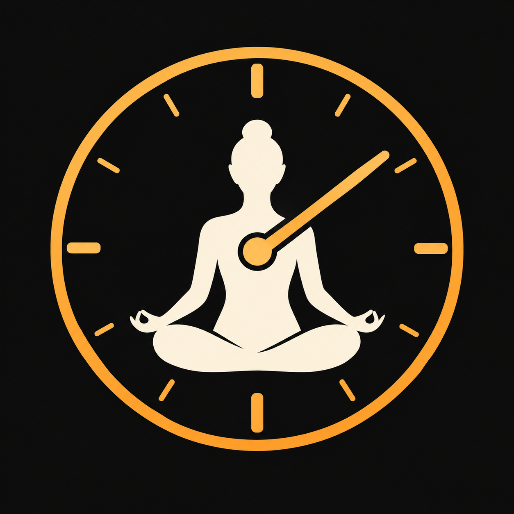

# Icon concept drafts

Generated with the built-in image-generation tool for comparison, not installed
in the asset catalog. The current shipping icon is unchanged. These are raster
concepts, not final production artwork; assess circular crops and small sizes
before choosing or refining one.

| Concept | Draft | Assessment |
| --- | --- | --- |
| Seated figure and dial |  | Direct yoga association; simplify hands/anatomy at small sizes. |
| Lotus and clock hand |  | Simplest silhouette; may suggest general meditation. |
| Rolled mat and timer |  | Distinctive yoga equipment cue; simplify shading and roll. |

## Prompts

Each used this common prompt, with the corresponding subject inserted:

> Use case: logo-brand. Create one square app icon concept draft for Teaching
> Timer, a watchOS yoga teaching clock. [SUBJECT] Flat vector-like design, high
> contrast, restrained warm accent against dark background, generous negative
> space, strong silhouette readable at tiny Watch icon size. Full square opaque
> background, central composition safe for circular cropping. No text, letters,
> numbers, watermark, device mockup, or presentation board. This is a standalone
> icon draft, not a screenshot.

Subjects:

- **Seated dial:** A clock dial surrounding a simple seated cross-legged yoga
  instructor silhouette. Bold readable figure, a single clear clock hand
  integrated into the dial, no detailed anatomy.
- **Lotus hand:** A minimal lotus of three broad simple petals integrated with
  one clear clock hand and a central pivot. Recognizably yoga and timing, no
  intricate petals.
- **Mat timer:** A rounded timer dial integrated with a subtle rolled yoga mat
  motif. Bold minimal geometry, a clearly readable clock hand, mat roll suggested
  with one simple curve, not a complex illustration.
